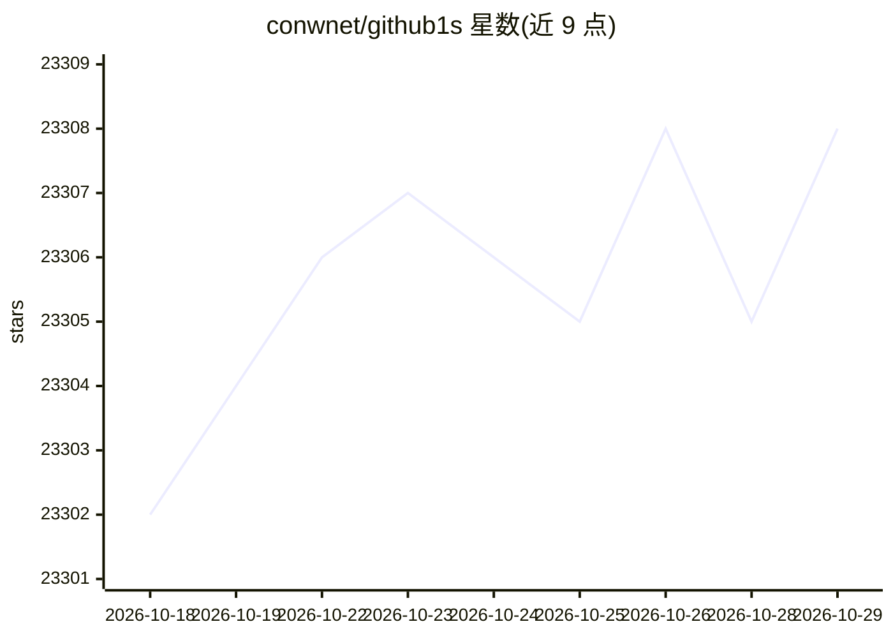

# conwnet/github1s

⭐ 23,308 · TypeScript · MIT · 推送 2026-10-21 · [GitHub](https://github.com/conwnet/github1s) · [官网](https://github1s.com) · 组织维护

**浏览器中秒开 GitHub 仓库的 VS Code 代码阅读器**

基于 VS Code 的浏览器端代码浏览工具：在仓库 URL 中插入 1s 即可在线浏览文件、搜索代码、查看提交历史与 PR/MR diff，无需克隆仓库。内置 AI 聊天面板可解释文件或选中代码并检索相关代码，用户自行配置可接受浏览器请求的模型端点。公共仓库免登录浏览，私有仓库需授权；远程仓库只读。另支持 GitLab 与 npm 包浏览，可通过开发指南本地运行。

## 筛选速览

| 维度 | 判定 | 备注 |
|---|---|---|
| AI 角色 | `ai-enhanced` | 去掉 AI 部分产品仍成立 |
| 许可风险 | `permissive` | MIT |
| 部署形态 | `None` |  |
| 模型依赖 | — | README 未给出锁定关系 |
| 硬件要求 | — | 无带数字的原话,不猜 |
| 安装摩擦 | `low` | 无编译、无系统依赖或容器化 |
| 成熟度 | — | 结构信号不足 |

## 动量与使用信号

- 维护:`active` — 距上次 push 2.0 天,年发版 9,43 位贡献者
- 涨星:近 1 天 **-2**(自 20261016 起算)
- 安装:github 包 `release-assets` 月下载无数据
- 平台:WEB · 协议:—

## 能力要点

- URL 插入 1s 即可浏览器内浏览仓库，无需克隆
- 基于 VS Code 界面的目录浏览、文件查找与代码搜索
- 内置 AI 聊天：解释文件/选中代码并检索相关代码
- 同时支持 GitHub、GitLab 与 npm 包浏览

## 适用场景

- 快速在线阅读 GitHub 仓库代码而不必克隆
- 查看分支、提交历史和 PR/MR 的 diff
- 借助 AI 聊天理解不熟悉的复杂代码

## 场景标签

 · 领域:开发者工具/代码浏览

## 证据(README 行号)

> L5: GitHub1s is a browser-based code explorer built on VS Code. Browse files, search code, and review changes without cl
> L34: ## 🤖 GitHub1s AI
> L32: Remote repositories are **read-only**. Search and code navigation depend on the repository platform and available u

## 星数曲线

2026-10-18 23,302 → 2026-10-29 23,308（+6）

---
*卡片 v1 · prompt 1.4 · 生成 2026-10-18 · 置信度 high · 依据 README sha `0620abb4d178` · [字段定义](../../DATASET.md)*
