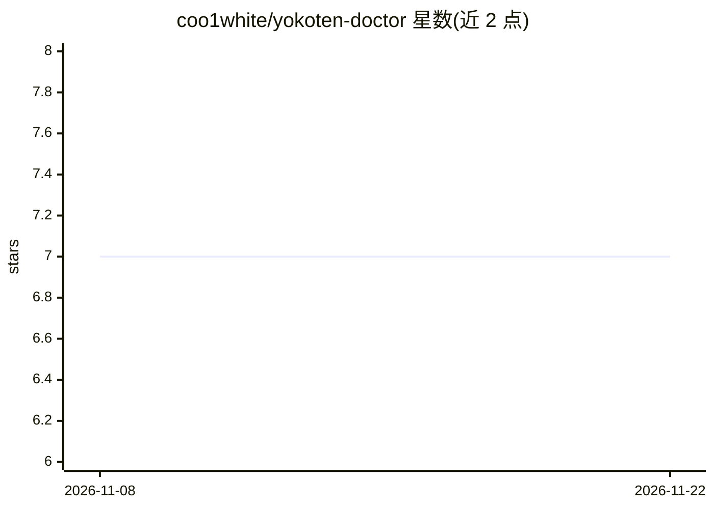

# coo1white/yokoten-doctor

⭐ 7 · Python · MIT · 推送 2026-11-04 · [GitHub](https://github.com/coo1white/yokoten-doctor) · [官网](https://doctor.yokoten.app) · 个人维护

**预览 AI 对你的仓库的理解并生成 AGENTS.md**

面向公开 GitHub 仓库的开发者工具：粘贴仓库 URL，由 Muse Spark Open 模型读取仓库并生成如何构建、如何测试、哪些文件不可改动的描述，用户确认后保存为 AGENTS.md；还可生成带代码行链接的风险审查报告。服务端为每次检查创建一次性 Modal 沙箱（复制文件、断网、不安装不运行仓库代码），并将结果哈希写入 Sigstore Rekor 与 Solana devnet 作为公开记录，可用 npx 命令离线校验运行文件未被篡改。为 Meta Global AI Developer Hackathon 的单人参赛项目，托管在 Modal 上。

## 筛选速览

| 维度 | 判定 | 备注 |
|---|---|---|
| AI 角色 | `ai-native` | 本体是模型或模型工具 |
| 许可风险 | `permissive` | MIT |
| 部署形态 | `library` | 以包/库形式分发 |
| 模型依赖 | — | README 未给出锁定关系 |
| 硬件要求 | — | 无带数字的原话,不猜 |
| 安装摩擦 | `low` | 无编译、无系统依赖或容器化 |
| 成熟度 | `idea` | |

## 能力要点

- 读取公开仓库生成 AGENTS.md 项目描述，已有时不覆盖
- 带代码行链接的审查报告，1-2 分钟生成
- 检查结果哈希写入 Sigstore Rekor 与 Solana devnet，可下载并本地校验
- 一次性沙箱断网运行，仓库代码不被安装、构建或执行

## 适用场景

- 让 coding agent 改代码前，先确认它对仓库构建/测试/禁区文件的理解
- 为公开仓库快速生成 AGENTS.md
- 获取 agent 改动前应知悉的项目风险清单
- 需要可验证的检查记录时下载运行文件并校验哈希

## 场景标签

`代码审查` · 领域:编码与开发

## 证据(README 行号)

> L17: AI coding agents read your repo before they change it. If they get the build, the tests, or the off-limits files wr
> L21: - **Paste a URL, see the AI's view.** Muse Spark Open reads the repo and writes how to build it, how to test it, an

## 星数曲线

2026-11-08 7 → 2026-11-22 7（+0）

---
*卡片 v1 · prompt 1.4 · 生成 2026-11-20 · 置信度 high · 依据 README sha `d27a9ecb6a54` · [字段定义](../../DATASET.md)*
