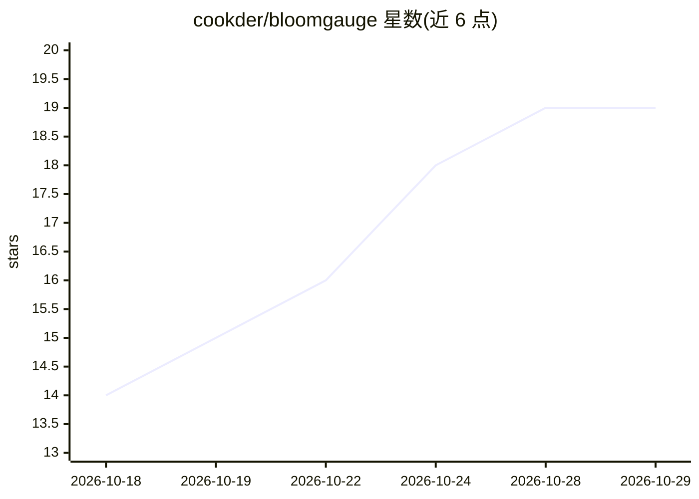

# cookder/bloomgauge

⭐ 19 · Python · NOASSERTION · 推送 2026-10-19 · [GitHub](https://github.com/cookder/bloomgauge) · [官网](https://bloomgauge.io) · 个人维护

**面向 Mac 上 Darkbloom 供给者的免费收益面板与模型管理器**

原生 macOS 应用（Swift 壳 + 内置 Python 后端 + React 本地面板），服务在 Apple Silicon Mac 上运行 Darkbloom 供给节点赚钱的用户：读取 ~/.darkbloom 的供给状态、Darkbloom 账户 API 的确认收益与公开网络需求数据，存入 SQLite 并在 127.0.0.1:8765 提供面板。Manager 保持选定模型运行并在停滞后恢复；可选的模型切换默认关闭，且每次切换需通过最短运行时长、改善幅度、每日次数、内存、空闲、电源与温度等检查。模型操作均经 Darkbloom 自身 CLI 完成，不触碰提现或凭据。限制：本仓库为源码可得核心（PolyForm Shield），滞后于官网应用；需 macOS 14+ 的 Apple Silicon Mac 与 Darkbloom 账户。

## 筛选速览

| 维度 | 判定 | 备注 |
|---|---|---|
| AI 角色 | `ai-ecosystem` | LLM/agent 周边工具 |
| 许可风险 | `none` | NOASSERTION |
| 部署形态 | `desktop` | 安装包/桌面程序 |
| 模型依赖 | — | README 未给出锁定关系 |
| 硬件要求 | — | 无带数字的原话,不猜 |
| 安装摩擦 | `low` | 无编译、无系统依赖或容器化 |
| 成熟度 | — | 结构信号不足 |

## 能力要点

- 展示确认收益、网络需求与硬件健康（CPU/GPU/内存/温度）
- Manager 保持模型运行并在停滞后恢复，可选切换需通过多项检查
- 通过自有 Tailscale 网络提供手机只读访问与最多十台 Mac 的汇总视图
- 提供签名公证的 .dmg 安装包，本地运行，使用数据分享默认关闭

## 适用场景

- 在 Mac 上供给 Darkbloom 推理并查看每小时确认收益
- 让模型在停滞后自动恢复、保持最佳计费模型在线
- 从手机经 Tailscale 远程查看收益与硬件状态

## 场景标签

 · 领域:桌面工具/分布式 AI 推理供给

## 证据(README 行号)

> L9: Darkbloom pays Mac owners to serve AI inference on idle hardware. What you earn depends heavily on which model your 
> L23: - **Manager**: keeps your chosen model running and recovers it after a stall (on after setup on a new Mac, off any 
> L67: Model changes go through Darkbloom's own CLI (`~/.darkbloom/bin/darkbloom`). BloomGauge never touches payouts, with

## 星数曲线

2026-10-18 14 → 2026-10-29 19（+5）

---
*卡片 v1 · prompt 1.4 · 生成 2026-10-28 · 置信度 mid · 依据 README sha `2db7655e1c16` · [字段定义](../../DATASET.md)*
