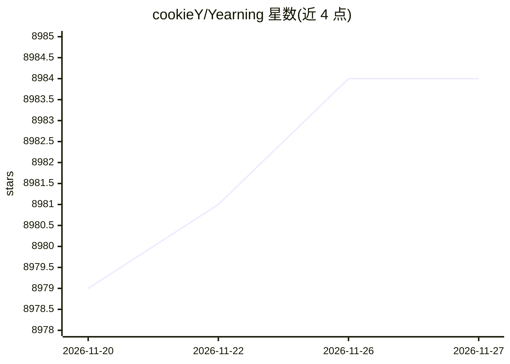

# cookieY/Yearning

⭐ 8,984 · Go · AGPL-3.0 · 推送 2026-11-26 · [GitHub](https://github.com/cookieY/Yearning) · [官网](https://v4.yearning.io/) · 组织维护 · 中文 README

**SQL 审核与数据库变更治理平台，AI 预检+审批+回滚**

面向 MySQL、PostgreSQL、TiDB、OceanBase、PolarDB 的 SQL 审核与数据库变更治理平台。以 Go 单体二进制加 React 前端加 PostgreSQL 元数据库构成。核心流程为 DDL/DML 工单提交前的确定性加 AI 两阶段预检，SQL 指纹折叠与标识符匿名化；提交后多级审批流程加密冻结；内置进程内 gh-ost 在线 DDL 与无 binlog 的跨引擎回滚；另提供受管控的只读查询工作区、敏感列掩码、Top SQL 性能诊断与 NL-to-SQL 助手。支持 OIDC/LDAP 企业认证，企业授权与商业支持通过邮件联系。

## 筛选速览

| 维度 | 判定 | 备注 |
|---|---|---|
| AI 角色 | `ai-native` | 本体是模型或模型工具 |
| 许可风险 | `dual` | AGPL-3.0 |
| 部署形态 | `self-host` | docker 或自建部署 |
| 模型依赖 | local-ok | 支持本地模型 |
| 硬件要求 | — | 无带数字的原话,不猜 |
| 安装摩擦 | `low` | 无编译、无系统依赖或容器化 |
| 成熟度 | — | 结构信号不足 |

## 能力要点

- 零泄漏 AI SQL 预检：指纹分组、内存匿名化、不可绕过提交门
- 提交时加密冻结的多级审批，admin 亦无法改派或跳过
- 内置进程内 gh-ost 在线 DDL 与基于 before-image 的跨引擎回滚
- 只读查询授权、服务端列掩码与流式导出管控

## 适用场景

- DBA 对生产库 SQL 变更做审批与审计
- 平台团队规范化数据库 CI/CD 流程
- 给开发者发放有时限的只读查询权限并掩码敏感列
- 诊断慢 SQL 并将索引建议转为受治理的变更工单

## 场景标签

`代码审查` `数据分析` · 领域:效率与自动化

## 证据(README 行号)

> L9: **AI-Powered Database Change Governance & SQL Review Platform**
> L94: Every DDL/DML change order must pass a deterministic + AI two-stage precheck before submission. Yearning lexes each
> L50: **Yearning v4** is a ground-up architectural rebuild of the open-source Yearning SQL audit and database governance 

## 星数曲线

2026-11-20 8,979 → 2026-11-27 8,984（+5）

---
*卡片 v1 · prompt 1.4 · 生成 2026-11-27 · 置信度 high · 依据 README sha `fb36b724906a` · [字段定义](../../DATASET.md)*
