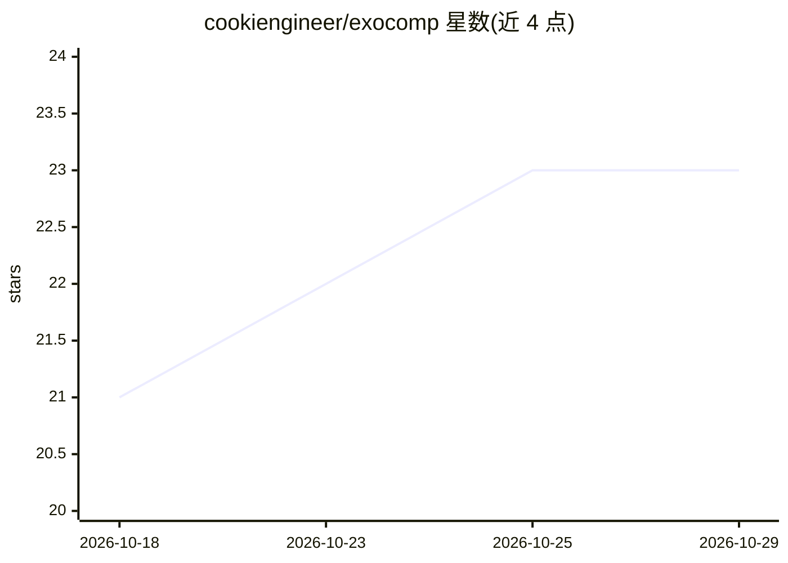

# cookiengineer/exocomp

⭐ 23 · C · 推送 2026-10-06 · [GitHub](https://github.com/cookiengineer/exocomp) · [官网](https://cookie.engineer/projects/agentic-research/exocomp.html) · 个人维护

**面向 Golang 的自托管多 Agent 开发与渗透测试环境**

用 Go 编写的自托管多 Agent 环境，为软件开发与渗透测试定义两类 Agent 角色（planner/architect/coder/tester 与 exploiter/reverser/threathunter 等），默认搭配 ollama 或 OpenAI 兼容推理服务器运行本地模型（如 Qwen3.6-abliterated）。Agent 通过 Tools 与以当前工作目录为边界的沙箱交互，含任务队列、子 Agent 生命周期管理、SKILL.md 技能加载等机制。Tools 仍在开发中，部分功能标注需 48GB VRAM GPU；采用 AGPL3/商业 EULA 双许可。

## 筛选速览

| 维度 | 判定 | 备注 |
|---|---|---|
| AI 角色 | `ai-ecosystem` | LLM/agent 周边工具 |
| 许可风险 | `none` | — |
| 部署形态 | `None` |  |
| 模型依赖 | local-ok | 支持本地模型 |
| 硬件要求 | — | 无带数字的原话,不猜 |
| 安装摩擦 | `low` | 无编译、无系统依赖或容器化 |
| 成熟度 | `idea` | |

## 能力要点

- 软件开发与渗透测试两套 Agent 角色体系，支持短生命周期子 Agent
- 沙箱以当前工作目录为边界，通过 Tools 与文件/容器/网站等交互
- 支持 ollama 快速上手与 OpenAI 兼容端点的外部推理服务器
- 实现 agentskills.io 规范的 SKILL.md 技能加载

## 适用场景

- 在本地沙箱中让多 Agent 协作完成 Golang 编码与单元测试
- 组织 Agent 执行漏洞发现、二进制逆向与 Web 扫描等安全任务
- 通过 Web UI 观察多个 Agent 的工作过程

## 场景标签

`多智能体` `编码 Agent` `网络安全` · 领域:Agent 开发

## 证据(README 行号)

> L3: Self-hosted multi-agent environment tailored to Golang.
> L132: The easiest way to use Exocomp is in combination with `ollama`. The provided
> L163: It's also possible to use exocomp with an external inference server

## 星数曲线

2026-10-18 21 → 2026-10-29 23（+2）

---
*卡片 v1 · prompt 1.4 · 生成 2026-10-27 · 置信度 high · 依据 README sha `56d25e75ecb7` · [字段定义](../../DATASET.md)*
