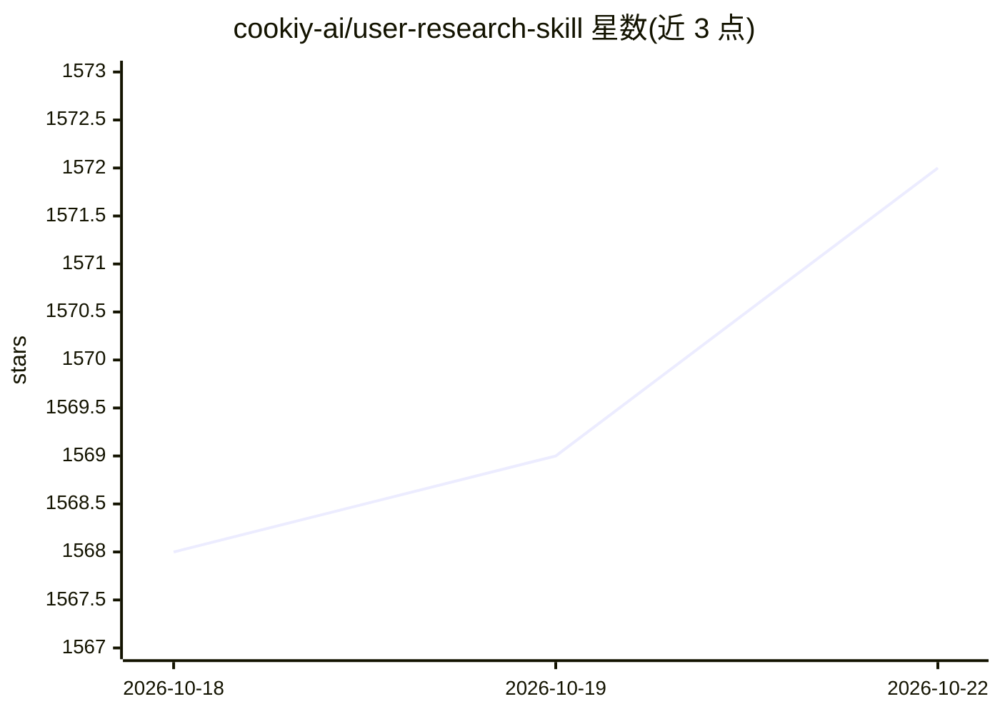

# cookiy-ai/user-research-skill

⭐ 1,572 · MIT · 推送 2026-10-19 · [GitHub](https://github.com/cookiy-ai/user-research-skill) · [官网](https://cookiy.ai) · 组织维护

**面向 AI agent 的用户研究技能：规划、执行并合成定性/定量研究**

MIT 许可的 agent 技能包，安装到 Claude Code、Codex、Cursor、OpenClaw 等 AI 平台后，可在对话内生成研究计划、筛选问卷与访谈指南，把访谈转录合成为带代码簿、人物画像和优先级发现的报告。连接 Cookiy AI 服务后可运行端到端研究：AI 主持的真实或合成参与者访谈、多语言条件逻辑问卷与受访者招募；网站 Web 应用与 CLI 技能数据互通。提供插件市场与 npx 两种安装方式。

## 筛选速览

| 维度 | 判定 | 备注 |
|---|---|---|
| AI 角色 | `ai-ecosystem` | LLM/agent 周边工具 |
| 许可风险 | `permissive` | MIT |
| 部署形态 | `library` | 以包/库形式分发 |
| 模型依赖 | locked-api |  |
| 硬件要求 | — | 无带数字的原话,不猜 |
| 安装摩擦 | `low` | 无编译、无系统依赖或容器化 |
| 成熟度 | — | 结构信号不足 |

## 能力要点

- 生成研究计划、筛选问卷与访谈指南
- 将访谈转录合成为含代码簿、画像与优先级发现的报告
- 经 Cookiy AI 运行 AI 主持访谈（真实/合成参与者）与多语言定量问卷并招募受访者
- 支持 Claude Code/Codex/Cursor/OpenClaw 等平台，Web 应用与 CLI 数据同步

## 适用场景

- 在 AI agent 中直接设计研究计划并产出访谈指南
- 把一批访谈转录整理成结构化研究报告
- 发起端到端研究：AI 访谈、问卷投放与受访者招募

## 场景标签

`科研工具` · 领域:学习与行业

## 证据(README 行号)

> L39: An AI agent skill that enables any AI platform to **plan, run, and synthesize user research** — both qualitative (i
> L41: Use it for **general-purpose research** (design research plans, interview guides, synthesize reports), or connect t

## 星数曲线

2026-10-18 1,568 → 2026-10-22 1,572（+4）

---
*卡片 v1 · prompt 1.4 · 生成 2026-10-21 · 置信度 high · 依据 README sha `cb9efb990b57` · [字段定义](../../DATASET.md)*
