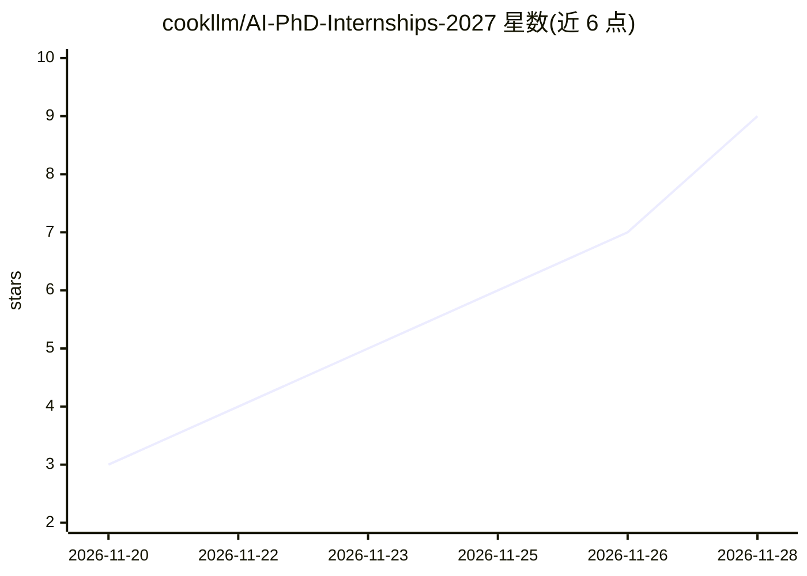

# cookllm/AI-PhD-Internships-2027

⭐ 9 · MIT · 推送 2026-11-25 · [GitHub](https://github.com/cookllm/AI-PhD-Internships-2027) · [官网](https://cookllm.com/en/jobs/board?utm_source=github&utm_medium=readme&utm_campaign=phd-internships&utm_content=about) · 个人维护

**面向 PhD 求职者的 2027 AI/ML 研究实习岗位清单**

按公司招聘页面每日更新的实习岗位列表：收录要求或偏好 PhD 的 AI/ML 研究类实习（research scientist、applied scientist、research engineer），覆盖 2027 夏季与 off-cycle 期限，按 LLM/NLP 等类别组织，附直接申请链接与更新时间，标注 "PhD or MS" 例外。另提供基于简历匹配的每日邮件推送服务（jobs membership）。本次可见内容含 327 个岗位、105 家公司。

## 筛选速览

| 维度 | 判定 | 备注 |
|---|---|---|
| AI 角色 | `ai-knowledge` | 知识聚合/清单类 |
| 许可风险 | `permissive` | MIT |
| 部署形态 | `None` |  |
| 模型依赖 | — | README 未给出锁定关系 |
| 硬件要求 | — | 无带数字的原话,不猜 |
| 安装摩擦 | `low` | 无编译、无系统依赖或容器化 |
| 成熟度 | — | 结构信号不足 |

## 能力要点

- 327 个开放实习岗位、105 家公司，每日从公司招聘页面更新
- 按 LLM and NLP 等类别组织，标注 "PhD or MS" 可申请项
- 每条岗位附直接申请链接与发布天数
- 提供基于简历匹配的每日邮件推送（付费 membership）

## 适用场景

- PhD 学生查找 2027 夏季及 off-cycle 的 AI 研究实习
- 按 LLM/NLP 等方向筛选目标公司的实习岗位
- 通过直接链接快速投递并跟踪岗位发布时间

## 场景标签

`精选清单` · 领域:学习与行业

## 证据(README 行号)

> L3: AI and machine learning research internships (research scientist, applied scientist, research engineer) that require
> L109: ## Internships from company career pages
> L111: ### LLM and NLP

## 星数曲线

2026-11-20 3 → 2026-11-28 9（+6）

---
*卡片 v1 · prompt 1.4 · 生成 2026-11-22 · 置信度 high · 依据 README sha `9fe111bac7f1` · [字段定义](../../DATASET.md)*
