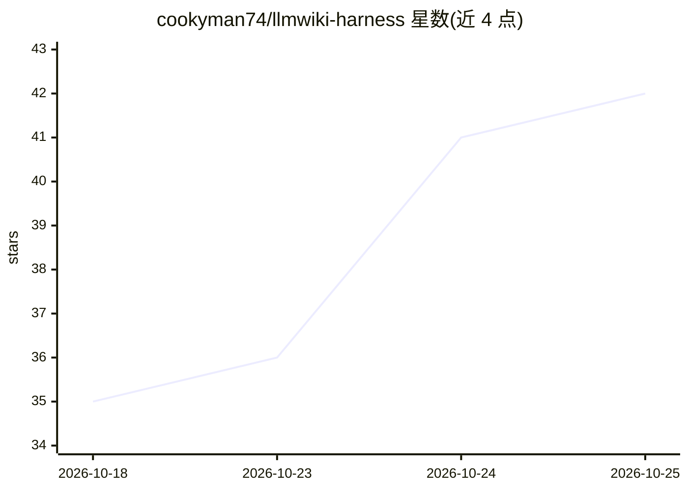

# cookyman74/llmwiki-harness

⭐ 44 · TypeScript · MIT · 推送 2026-09-25 · [GitHub](https://github.com/cookyman74/llmwiki-harness) · 个人维护

**用 Claude Code 维护 Obsidian 个人维基的自维护知识库脚手架**

面向个人知识管理用户的 Claude Code harness：在 Obsidian 仓库上部署 6 个 agent、8 个技能与 10 个确定性脚本，让 LLM 执行摄入、问答、交叉引用、矛盾标记与整理，逐步构建持久维基。采用三层存储（raw/wiki/CLAUDE.md）与四层记忆（工作/情景/语义/程序），按出现次数做晋升与遗忘（Ebbinghaus 衰减）。v2.1 引入懒摄入与模型路由（摄入用 sonnet、高推理用 opus）。附 MCP 服务器（Node≥20，只读），可在 Codex/Cursor 等 8 种客户端访问。会议纪要管线按敏感度在本地 mlx-whisper 与 OpenAI API 间分流，且不支持说话人分离。README 为韩文，需要 Claude Code 与 python3。

## 筛选速览

| 维度 | 判定 | 备注 |
|---|---|---|
| AI 角色 | `ai-native` | 本体是模型或模型工具 |
| 许可风险 | `permissive` | MIT |
| 部署形态 | `None` |  |
| 模型依赖 | locked-api |  |
| 硬件要求 | — | 无带数字的原话,不猜 |
| 安装摩擦 | `medium` | 含编译或系统依赖之一 |
| 成熟度 | — | 结构信号不足 |

## 能力要点

- 三层存储 + 四层记忆（L1–L4）与按重复次数晋升的遗忘机制
- 6 agent/8 技能/10 确定性脚本，计算零 LLM token
- 懒摄入 + 模型路由降低摄入成本
- 只读 MCP 服务器供 8 种外部客户端检索维基

## 适用场景

- 把网页剪辑、论文等原始资料持续沉淀为互相链接的个人维基
- 向自己的知识库提问并获得带可信度与出处的回答
- 会议录音转纪要并按敏感度选择本地或 API 转写
- 在其他 IDE/CLI 中通过 MCP 检索该维基

## 场景标签

`知识库管理` `语音识别` · 领域:知识与检索

## 证据(README 行号)

> L11: > Obsidian을 IDE로, LLM을 프로그래머로, 위키를 코드베이스로. 사용자는 소스를 큐레이션하고 질문하고, LLM이 요약·교차참조·정리·부기(bookkeeping)를 전부 한다.
> L43: **LLM Wiki**는 다르다. LLM이 원본 소스와 당신 사이에 **영속적인 위키**(구조화·상호링크된 마크다운 파일 모음)를 **점진적으로 만들고 유지**한다. 새 소스를 넣으면 LLM은:
> L204: |**wiki-synthesizer**|질의 응답 — index→MoC→L3 탐색, 신뢰도·최신성 반영 인용 답변, 환류|wiki-query, wiki-moc|opus|

## 星数曲线

2026-10-18 35 → 2026-10-25 42（+7）

---
*卡片 v1 · prompt 1.4 · 生成 2026-10-25 · 置信度 high · 依据 README sha `78bcaf48b44b` · [字段定义](../../DATASET.md)*
