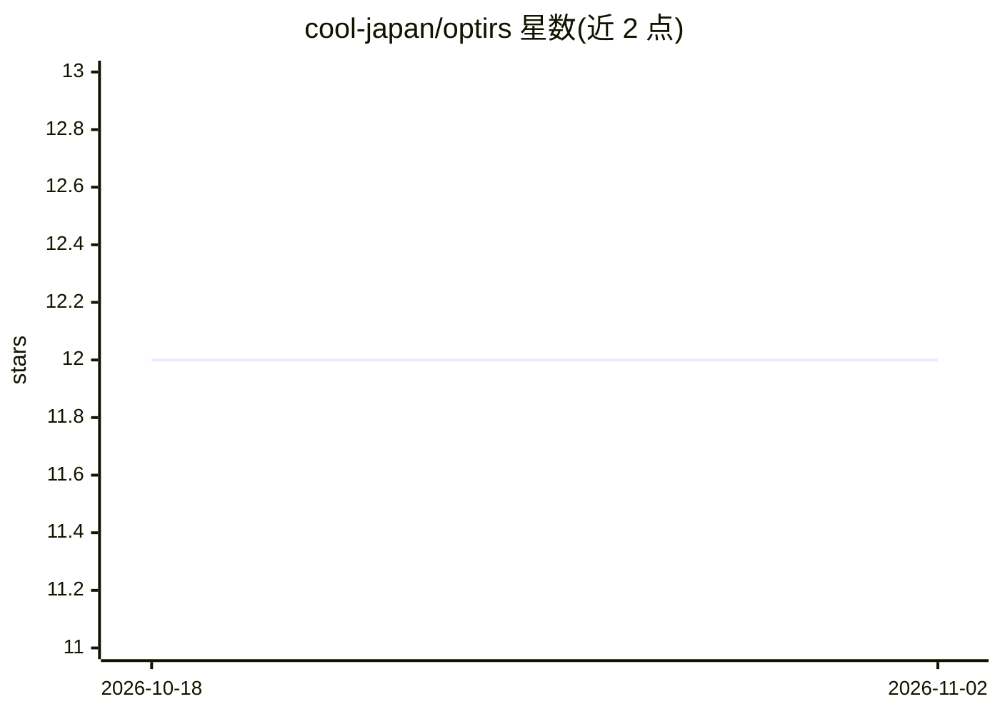

# cool-japan/optirs

⭐ 12 · Rust · Apache-2.0 · 推送 2026-09-16 · [GitHub](https://github.com/cool-japan/optirs) · [官网](https://github.com/cool-japan/optirs) · 组织维护

**面向 Rust 的机器学习优化库，基于 SciRS2 构建**

OptiRS 是以 Rust 编写的机器学习优化库，构建于 SciRS2 科学计算生态之上，服务需要在 Rust 中训练或调优模型的研究者与开发者。核心 crate 提供二十余种优化器（SGD/Adam/LAMB/Lion 等）、学习率调度器、正则化、梯度与损失景观分析、SIMD/并行/内存高效路径及差分隐私与联邦优化；另有 GPU（Metal 可用，CUDA/ROCm 无后端）、CPU 参考实现的 TPU 风格协调、学习型优化器、神经架构搜索、基准测试与 WASM 绑定等独立 crate。通过 Cargo 以 crate 依赖方式安装。

## 筛选速览

| 维度 | 判定 | 备注 |
|---|---|---|
| AI 角色 | `ai-ecosystem` | LLM/agent 周边工具 |
| 许可风险 | `permissive` | Apache-2.0 |
| 部署形态 | `None` |  |
| 模型依赖 | — | README 未给出锁定关系 |
| 硬件要求 | — | 无带数字的原话,不猜 |
| 安装摩擦 | `medium` | 含编译或系统依赖之一 |
| 成熟度 | `idea` | |

## 能力要点

- optirs-core 提供 SGD/Adam/LAMB/Lion 等 20+ 优化器与多种学习率调度器
- SIMD、多核并行与梯度累积的内存高效路径
- 差分隐私与联邦优化（含 Bonawitz 安全聚合协议）
- Metal 后端可端到端运行六种优化器；CUDA/ROCm 无后端，TPU 为 CPU 参考实现

## 适用场景

- 在 Rust 项目中训练模型时替换或组合优化器与调度器
- 检测梯度消失/爆炸并做损失景观分析
- 用 Criterion 基准在不同硬件上测量优化器性能
- 进行差分隐私或联邦学习场景下的优化实验

## 场景标签

`模型训练` · 领域:训练与推理

## 证据(README 行号)

> L6: OptiRS is a machine-learning optimization library for Rust, built on the
> L8: optimizers, learning-rate schedulers, regularizers and gradient tooling in `optirs-core`,
> L9: plus separate crates for GPU acceleration, TPU-style coordination, learned optimizers,

## 星数曲线

2026-10-18 12 → 2026-11-02 12（+0）

---
*卡片 v1 · prompt 1.4 · 生成 2026-11-01 · 置信度 high · 依据 README sha `0dc85769ce67` · [字段定义](../../DATASET.md)*
