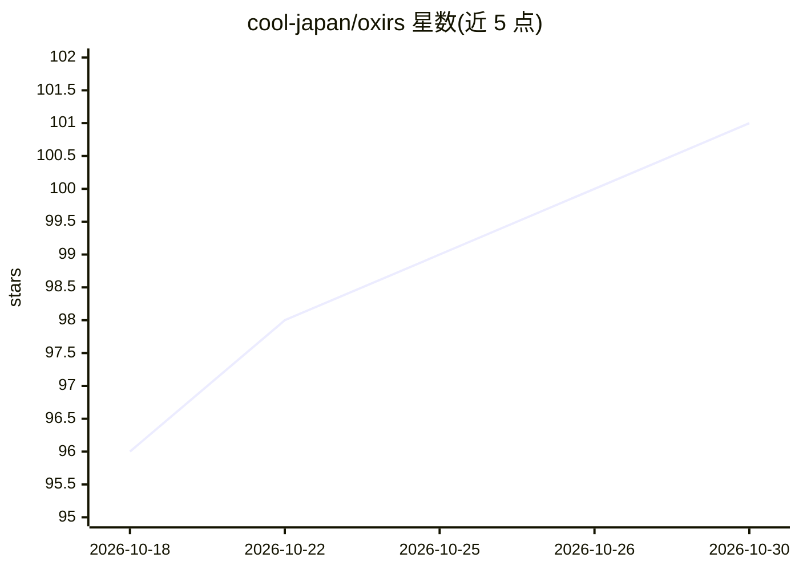

# cool-japan/oxirs

⭐ 101 · Rust · Apache-2.0 · 推送 2026-09-12 · [GitHub](https://github.com/cool-japan/oxirs) · [官网](https://github.com/cool-japan/oxirs) · 组织维护

**Rust 实现的语义网平台：SPARQL 1.2/GraphQL 服务与 AI 增强推理**

面向语义网开发者的 Rust-native 模块化平台，定位为 Apache Jena + Fuseki 的 JVM-free 替代：以 27 个 crate 的 workspace 提供 SPARQL 1.1/1.2 查询引擎、GraphQL 端点（含 RDF 词汇驱动的 schema 自动生成）、TDB2 磁盘存储后端、SHACL 校验、Raft 集群、DID/SSO 认证等。AI 部分为集成能力：向量检索、图嵌入（TransE/RotatE）、LLM 增强查询与 oxirs-shacl-ai。CLI 需从源码构建，库 crate 发布于 crates.io。v0.4.1 为生产加固版本，修复认证绕过、SPARQL 注入等安全问题。

## 筛选速览

| 维度 | 判定 | 备注 |
|---|---|---|
| AI 角色 | `ai-enhanced` | 去掉 AI 部分产品仍成立 |
| 许可风险 | `permissive` | Apache-2.0 |
| 部署形态 | `desktop` | 安装包/桌面程序 |
| 模型依赖 | — | README 未给出锁定关系 |
| 硬件要求 | — | 无带数字的原话,不猜 |
| 安装摩擦 | `medium` | 含编译或系统依赖之一 |
| 成熟度 | — | 结构信号不足 |

## 能力要点

- SPARQL 1.1/1.2 与 GraphQL 双协议端点服务同一数据集
- 27 个 crate 组成的模块化 workspace，46,255 个测试通过
- TDB2 持久磁盘存储与 mmap 快照格式（亚秒级冷启动）
- 向量检索、KGE 图嵌入（TransE/RotatE）与 LLM 增强查询集成

## 适用场景

- 部署 SPARQL/GraphQL 双协议的 RDF 数据服务替代 Jena Fuseki
- 对知识图谱执行 SHACL 校验与 LLM 增强查询
- 以单二进制形式在资源受限环境运行语义网数据平台

## 场景标签

`知识图谱` · 领域:知识与检索

## 证据(README 行号)

> L18: OxiRS aims to be a **Rust-first, JVM-free** alternative to Apache Jena + Fuseki and to Juniper, providing:
> L22: - **AI readiness**: Native integration with vector search, graph embeddings, and LLM-augmented querying
> L3: > A Rust-native, modular platform for Semantic Web, SPARQL 1.2, GraphQL, and AI-augmented reasoning

## 星数曲线

2026-10-18 96 → 2026-10-30 101（+5）

---
*卡片 v1 · prompt 1.4 · 生成 2026-10-23 · 置信度 high · 依据 README sha `2ec589b4389e` · [字段定义](../../DATASET.md)*
