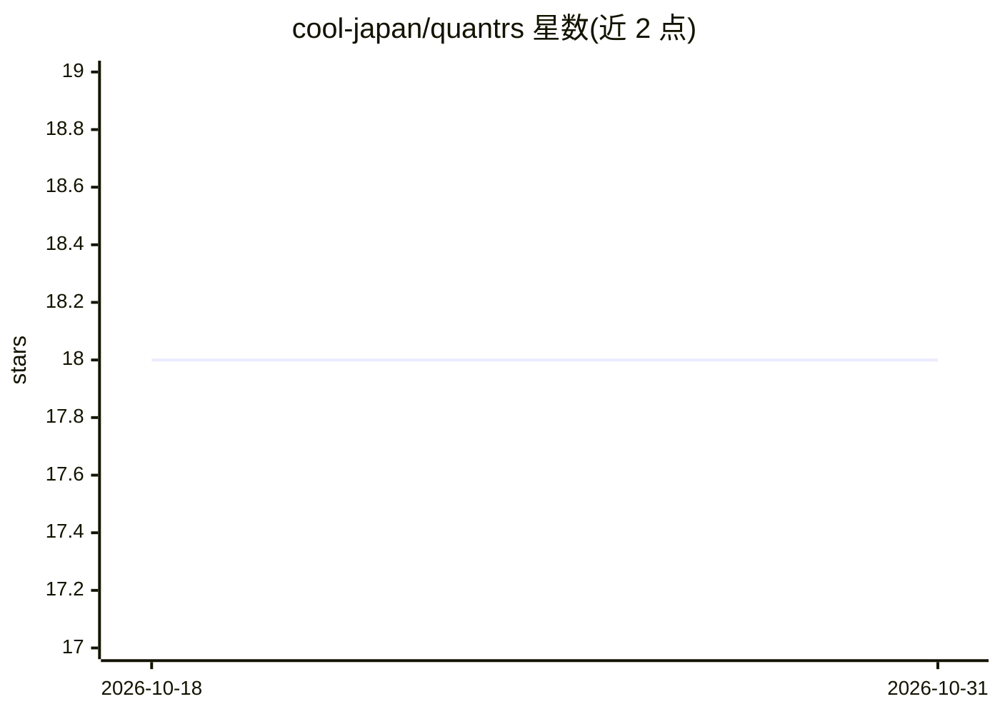

# cool-japan/quantrs

⭐ 18 · Rust · Apache-2.0 · 推送 2026-09-16 · [GitHub](https://github.com/cool-japan/quantrs) · 组织维护

**纯 Rust 量子计算框架：量子模拟、算法与硬件接入**

QuantRS2 是以 11 个 crate 组成的 Rust 量子计算工作区，覆盖量子电路表示（const generics 编译期验证量子比特数）、态矢量与张量网络模拟、量子退火（含 D-Wave 集成）、量子机器学习（QNN/GAN）以及远程硬件连接（IBM Quantum、Azure Quantum）。全程纯 Rust 实现（OxiBLAS 替代 OpenBLAS），无需外部 C/C++ 依赖；支持并行执行与 WGPU GPU 加速等可选特性。所有 crate 均处于 Alpha 状态，另有 PyO3 Python 绑定。

## 筛选速览

| 维度 | 判定 | 备注 |
|---|---|---|
| AI 角色 | `ai-ecosystem` | LLM/agent 周边工具 |
| 许可风险 | `permissive` | Apache-2.0 |
| 部署形态 | `library` | 以包/库形式分发 |
| 模型依赖 | — | README 未给出锁定关系 |
| 硬件要求 | — | 无带数字的原话,不猜 |
| 安装摩擦 | `medium` | 含编译或系统依赖之一 |
| 成熟度 | `idea` | |

## 能力要点

- 门模型与量子退火双范式支持
- 态矢量/张量网络/稳定子多种模拟后端
- 内置 QAOA、Grover、QFT、VQE 等算法与量子纠错码
- 可选接入 IBM Quantum 硬件与 D-Wave 退火

## 适用场景

- 在纯 Rust 环境中构建与模拟量子电路
- 运行 QAOA/VQE 等变分量子算法做组合优化或化学模拟
- 提交电路到 IBM 真实量子硬件
- 用量子退火求解 MaxCut、TSP 等问题

## 场景标签

 · 领域:量子计算/科学计算

## 证据(README 行号)

> L18: QuantRS2 (`/kwɒntərz tu:/`) is a comprehensive Rust-based quantum computing framework that provides a modular, high
> L68: - **quantrs2-ml**: Quantum machine learning including QNNs, GANs, and specialized HEP classifiers

## 星数曲线

2026-10-18 18 → 2026-10-31 18（+0）

---
*卡片 v1 · prompt 1.4 · 生成 2026-10-29 · 置信度 low · 依据 README sha `9f544aa28d3a` · [字段定义](../../DATASET.md)*
