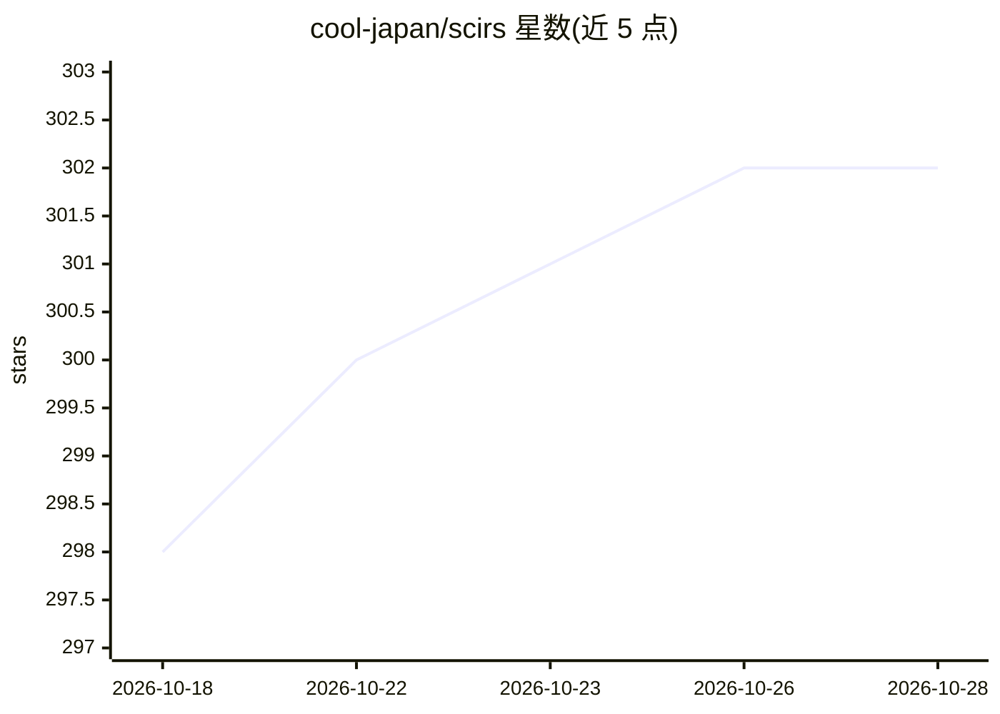

# cool-japan/scirs

⭐ 302 · Rust · Apache-2.0 · 推送 2026-10-08 · [GitHub](https://github.com/cool-japan/scirs) · [官网](https://github.com/cool-japan/scirs) · 组织维护

**纯 Rust 科学计算与 AI/ML 基础设施库，提供 SciPy 兼容 API**

SciRS2 是以纯 Rust 编写的科学计算与机器学习基础设施库，目标是提供 SciPy 兼容 API，覆盖线性代数、统计、FFT、信号处理、计算机视觉与神经网络等模块，组织为 29 个 workspace crate。默认构建零 C/C++/Fortran 依赖（BLAS/FFT/HDF5 等由 OxiBLAS、OxiFFT、oxih5 等纯 Rust crate 实现），支持 Linux/macOS/Windows/WebAssembly。通过 crates.io 与 cargo 安装使用。限制：v0.6.5 前 autograd 等模块存在大量正确性修复记录，README 自述接近完成实现。

## 筛选速览

| 维度 | 判定 | 备注 |
|---|---|---|
| AI 角色 | `ai-ecosystem` | LLM/agent 周边工具 |
| 许可风险 | `permissive` | Apache-2.0 |
| 部署形态 | `library` | 以包/库形式分发 |
| 模型依赖 | — | README 未给出锁定关系 |
| 硬件要求 | — | 无带数字的原话,不猜 |
| 安装摩擦 | `high` | 编译与系统依赖俱全 |
| 成熟度 | `idea` | |

## 能力要点

- 29 个 workspace crate 覆盖线性代数/统计/ML/FFT/信号处理/计算机视觉
- 默认纯 Rust，零 C/C++/Fortran 系统依赖，跨平台含 WebAssembly
- 38,768 测试（all-features）+ 5,136 文档测试，3.1M+ 行 Rust 代码
- 提供 autograd、模型打包（native/C 共享库）、DLPack 互操作等 ML 基础设施

## 适用场景

- 在 Rust 项目中做科学计算与数据分析，无需 C/Fortran 依赖
- 构建和训练神经网络模型并打包为原生二进制部署
- 将 NumPy/SciPy 风格的工作流迁移到 Rust 或 wasm 环境

## 场景标签

 · 领域:科学计算/机器学习基础设施

## 证据(README 行号)

> L10: SciRS2 is a comprehensive scientific computing and AI/ML infrastructure in **Pure Rust**, providing SciPy-compatibl
> L28: 📊 **Comprehensive**: Linear algebra, statistics, ML, FFT, signal processing, computer vision, and more

## 星数曲线

2026-10-18 298 → 2026-10-28 302（+4）

---
*卡片 v1 · prompt 1.4 · 生成 2026-10-21 · 置信度 high · 依据 README sha `2cd29f1cca97` · [字段定义](../../DATASET.md)*
