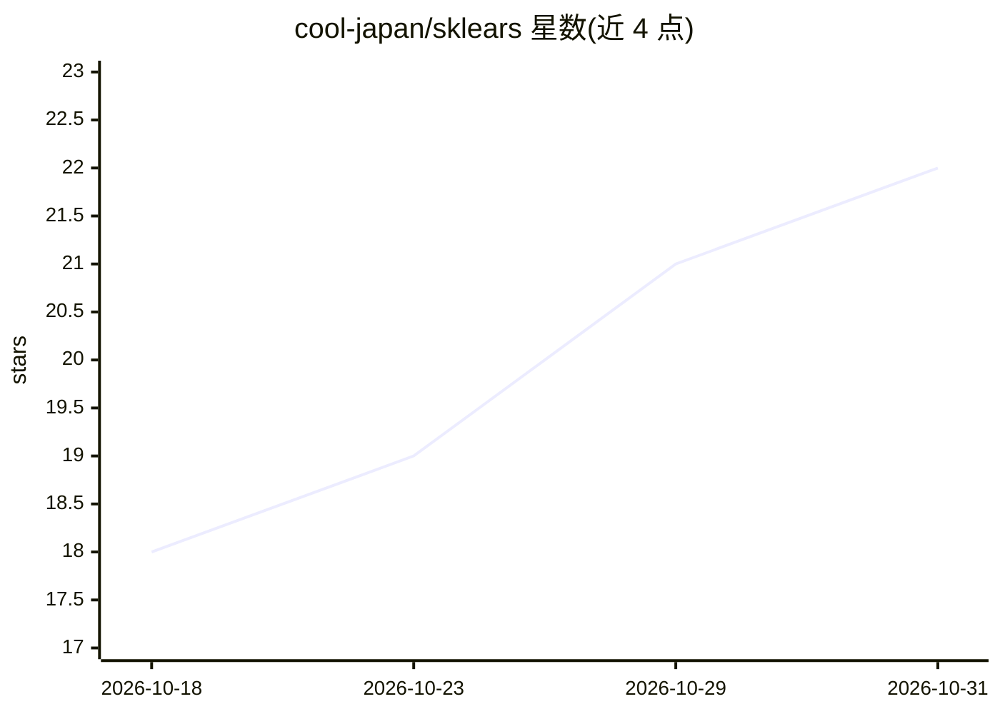

# cool-japan/sklears

⭐ 22 · Rust · Apache-2.0 · 推送 2026-09-14 · [GitHub](https://github.com/cool-japan/sklears) · [官网](https://github.com/cool-japan/sklears) · 组织维护

**Rust 实现的机器学习库，复刻 scikit-learn API**

纯 Rust 实现的机器学习库，按 scikit-learn 的 API 组织 36 个子 crate，覆盖线性模型、树模型、SVM、神经网络、聚类、降维、高斯过程、集成方法、预处理与模型选择，宣称 0.2.0 版本对应 >99% 的 scikit-learn API 覆盖率与 12,721 个测试。给 Rust 开发者与需要从 Python 迁移 ML 工作流的团队使用。关键机制：编译期类型状态机（未训练模型无法调用 predict）、Rayon 并行、SIMD、可选 CUDA 后端（oxicuda，无驱动时回退 CPU）、PyO3 Python 绑定。部分 crate 仍为 Alpha 状态且存在约 1,123 个 stub。

## 筛选速览

| 维度 | 判定 | 备注 |
|---|---|---|
| AI 角色 | `ai-native` | 本体是模型或模型工具 |
| 许可风险 | `permissive` | Apache-2.0 |
| 部署形态 | `library` | 以包/库形式分发 |
| 模型依赖 | — | README 未给出锁定关系 |
| 硬件要求 | — | 无带数字的原话,不猜 |
| 安装摩擦 | `medium` | 含编译或系统依赖之一 |
| 成熟度 | — | 结构信号不足 |

## 能力要点

- 36 个 crate 按 scikit-learn API 组织，覆盖回归/分类/聚类/降维/集成/模型选择
- 编译期类型状态机：未 fit 的模型调用 predict 会编译报错
- 可选 CUDA 后端（oxicuda），无驱动时透明回退 CPU/Rayon
- PyO3 绑定 sklears-python，暴露预处理/聚类/模型选择工具

## 适用场景

- 在 Rust 项目中直接做回归、分类、聚类等机器学习任务
- 把已有 scikit-learn 流水线迁移到 Rust 以脱离 Python 运行时
- 按需启用 feature flags 只编译所需算法模块

## 场景标签

 · 领域:机器学习库/科学计算

## 证据(README 行号)

> L3: A comprehensive machine learning library in Rust, inspired by scikit-learn's intuitive API and combining it with Rus
> L14: sklears brings the familiar scikit-learn API to Rust, aiming for comprehensive compatibility while leveraging Rust'
> L64: - **Supervised Learning**: Regression, classification, and ranking

## 星数曲线

2026-10-18 18 → 2026-10-31 22（+4）

---
*卡片 v1 · prompt 1.4 · 生成 2026-10-28 · 置信度 mid · 依据 README sha `efc8a9515381` · [字段定义](../../DATASET.md)*
