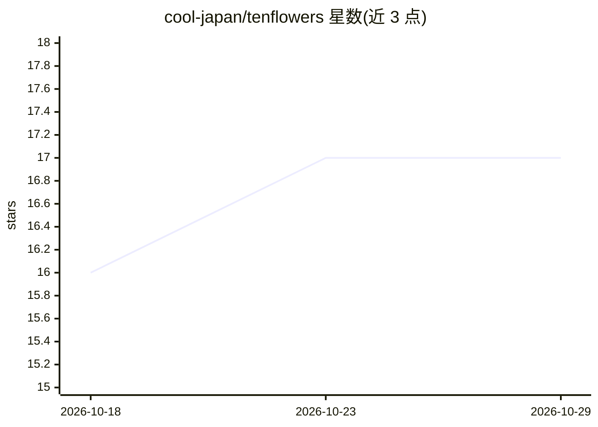

# cool-japan/tenflowers

⭐ 17 · Rust · Apache-2.0 · 推送 2026-09-12 · [GitHub](https://github.com/cool-japan/tenflowers) · [官网](https://github.com/cool-japan/tenflowers) · 组织维护

**纯 Rust 实现的机器学习框架，复刻 TensorFlow 架构**

面向 Rust 开发者的机器学习框架，以 TensorFlow 架构为蓝本，提供张量运算、自动微分（GradientTape）、神经网络层、9 种优化器、数据加载管线与 ONNX 导入导出。核心 100% Rust 实现，默认构建无 C/Fortran 依赖，通过 WGPU 支持 Metal/Vulkan/DirectX 跨平台 GPU 加速。另提供 PyO3 的 Python 绑定（alpha、未发布），支持 PyTorch 风格的 .backward() 隐式自动微分。以 cargo crate 工作区形式分发，含 6 个 crate 与 14,536+ 测试；FFI 功能存在两处已记录的窄缺口。

## 筛选速览

| 维度 | 判定 | 备注 |
|---|---|---|
| AI 角色 | `ai-ecosystem` | LLM/agent 周边工具 |
| 许可风险 | `permissive` | Apache-2.0 |
| 部署形态 | `None` |  |
| 模型依赖 | — | README 未给出锁定关系 |
| 硬件要求 | — | 无带数字的原话,不猜 |
| 安装摩擦 | `medium` | 含编译或系统依赖之一 |
| 成熟度 | `idea` | |

## 能力要点

- 纯 Rust 实现，默认构建无 C/C++/Fortran 依赖
- WGPU 跨平台 GPU 加速（Metal/Vulkan/DirectX）
- PyO3 Python 绑定支持 PyTorch 风格隐式 autograd 训练
- ONNX 模型导入导出，双执行模式（eager + 静态图）

## 适用场景

- 在 Rust 项目中训练和部署神经网络模型
- 通过 Python 绑定用 PyTorch 风格 API 进行训练
- 利用 ONNX 与其他 ML 框架交换模型

## 场景标签

`模型训练` `推理引擎` · 领域:训练与推理

## 证据(README 行号)

> L34: TenfloweRS is a native Rust machine learning framework inspired by TensorFlow, designed to bring the power of deep 
> L62: - **Dual Execution Modes**: Both eager execution (PyTorch-style) and static computation graphs (TensorFlow-style)

## 星数曲线

2026-10-18 16 → 2026-10-29 17（+1）

---
*卡片 v1 · prompt 1.4 · 生成 2026-10-29 · 置信度 high · 依据 README sha `2027e6f0daa4` · [字段定义](../../DATASET.md)*
