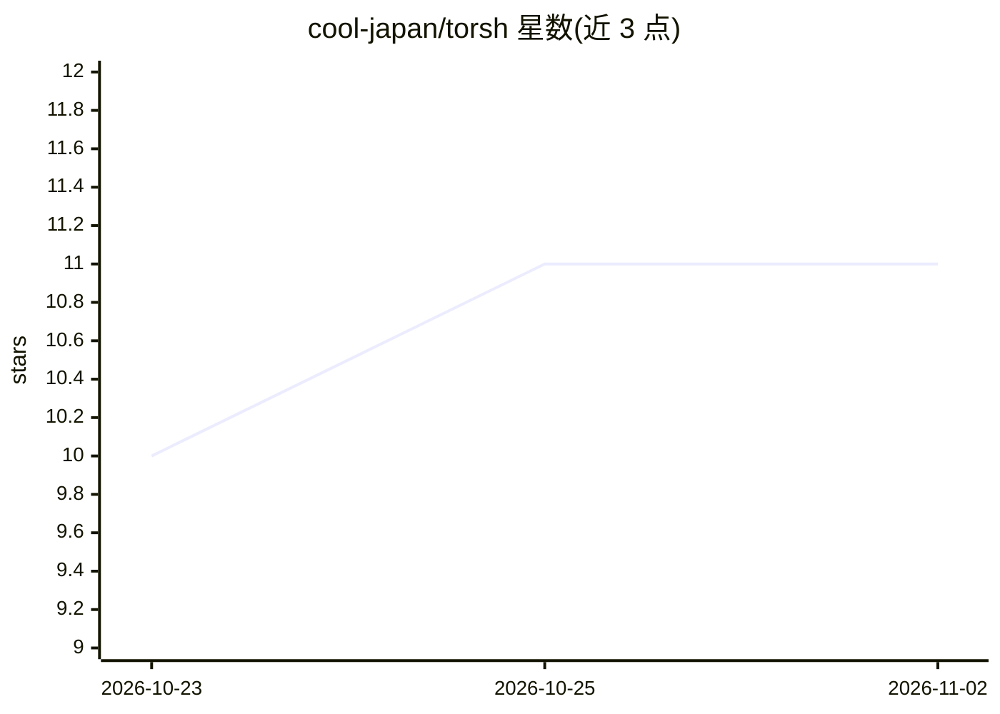

# cool-japan/torsh

⭐ 11 · Rust · Apache-2.0 · 推送 2026-09-12 · [GitHub](https://github.com/cool-japan/torsh) · [官网](https://github.com/cool-japan/torsh) · 组织维护

**纯 Rust 编写的 PyTorch 兼容深度学习框架**

ToRSh（Tensor Operations in Rust with Sharding）是以 Rust 实现的深度学习框架，声称对多数 PyTorch 代码可作替换，含自动微分、NN 层（含 Transformer/注意力）、优化器、图神经网络、时间序列、视觉空间操作等模块，通过 32 个 workspace crate 模块化组织，并集成 19 个 SciRS2 crate。CPU（SIMD AVX2/NEON）后端标注为可用，CUDA/Metal/WebGPU 为实验性且 feature-gated；NCCL 后端为占位实现，f16/bf16 部分支持。提供 PyO3 Python 绑定（import rstorch）与 C/N-API FFI。以 Cargo.toml 依赖方式安装。

## 筛选速览

| 维度 | 判定 | 备注 |
|---|---|---|
| AI 角色 | `ai-ecosystem` | LLM/agent 周边工具 |
| 许可风险 | `permissive` | Apache-2.0 |
| 部署形态 | `library` | 以包/库形式分发 |
| 模型依赖 | — | README 未给出锁定关系 |
| 硬件要求 | — | 无带数字的原话,不猜 |
| 安装摩擦 | `medium` | 含编译或系统依赖之一 |
| 成熟度 | `idea` | |

## 能力要点

- 声称 PyTorch 兼容 API，提供迁移指南
- 32 个模块化 crate，覆盖 GNN、时间序列、视觉、量化等
- 集成 19 个 SciRS2 crate 的科学计算能力
- 单一二进制部署，无需 Python 运行时（默认特性）

## 适用场景

- 在 Rust 项目中构建和训练神经网络，复用 PyTorch 式 API
- 在无 Python 环境的边缘/嵌入式设备上部署模型
- 进行图神经网络、时间序列等科学计算任务

## 场景标签

`模型训练` `推理引擎` · 领域:训练与推理

## 证据(README 行号)

> L15: ToRSh (Tensor Operations in Rust with Sharding) is a **PyTorch-compatible deep learning framework** built entirely 
> L51: - 🚀 **PyTorch Compatible**: Drop-in replacement for most PyTorch code

## 星数曲线

2026-10-23 10 → 2026-11-02 11（+1）

---
*卡片 v1 · prompt 1.4 · 生成 2026-11-02 · 置信度 high · 依据 README sha `d0063047e14a` · [字段定义](../../DATASET.md)*
