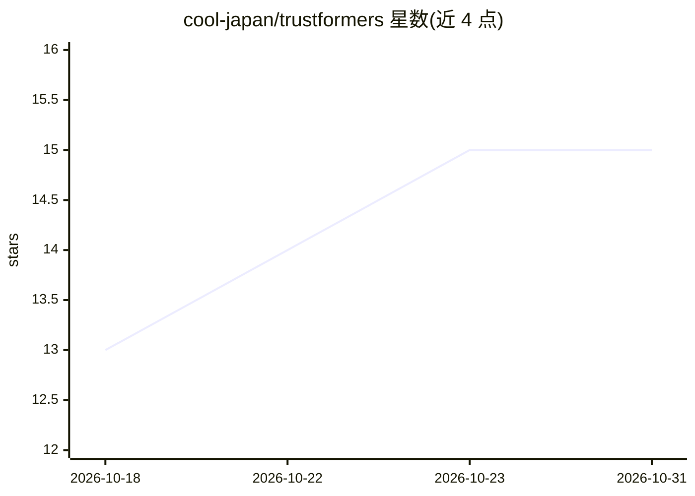

# cool-japan/trustformers

⭐ 15 · Rust · Apache-2.0 · 推送 2026-09-14 · [GitHub](https://github.com/cool-japan/trustformers) · [官网](https://github.com/cool-japan/trustformers) · 组织维护

**Rust 实现的 Transformers 库：加载 HF 模型做推理与训练**

以 Pure Rust 重写的 Hugging Face Transformers 栈：10 个 crate、约 1.53M 行代码，实现 49+ 种 transformer 架构（BERT/GPT-2/LLaMA/Mamba 等），提供 AutoModel/AutoTokenizer 与 pipeline API，直接加载 Hugging Face 模型格式（SafeTensors 内存映射）。支持 WebAssembly、REST/gRPC/GraphQL 服务端、iOS/Android 移动端部署与 RLHF/DPO 训练脚手架。关键限制：计算路径以 CPU 与 f32 为主，GPU（CUDA/Metal/WebGPU）目前端到端打通仅覆盖 GPT-2 与 RetNet；项目自述处于 alpha 阶段。

## 筛选速览

| 维度 | 判定 | 备注 |
|---|---|---|
| AI 角色 | `ai-ecosystem` | LLM/agent 周边工具 |
| 许可风险 | `permissive` | Apache-2.0 |
| 部署形态 | `None` |  |
| 模型依赖 | — | README 未给出锁定关系 |
| 硬件要求 | `cpu-ok` | |
| 安装摩擦 | `medium` | 含编译或系统依赖之一 |
| 成熟度 | `idea` | |

## 能力要点

- 49+ transformer 架构的 Pure Rust 实现，10 个 crate 约 1.53M 行
- 直接加载 Hugging Face 模型格式（SafeTensors 零拷贝内存映射）
- 多平台打包：WebAssembly、REST/gRPC/GraphQL 服务端、iOS/Android 移动端
- FlashAttention-2、PagedAttention、INT8/INT4（GPTQ/AWQ）量化、ZeRO 分布式训练

## 适用场景

- 在 Rust 项目中加载并运行 Hugging Face 格式的 transformer 模型
- 将模型部署到浏览器（WASM/WebGPU）或移动端
- 用 Rust 做模型推理与服务化，替代 Python 栈
- 进行 RLHF/DPO 训练实验

## 场景标签

`推理引擎` · 领域:训练与推理

## 证据(README 行号)

> L7: A high-performance, memory-safe Rust implementation of Hugging Face Transformers. TrustformeRS brings the power of t
> L27: TrustformeRS follows a modular workspace structure inspired by Hugging Face Transformers:
> L49: ```toml

## 星数曲线



2026-10-18 13 → 2026-10-31 15（+2）


---
*卡片 v1 · prompt 1.4 · 生成 2026-10-30 · 置信度 high · 依据 README sha `6048731e6ce3` · [字段定义](../../DATASET.md)*
