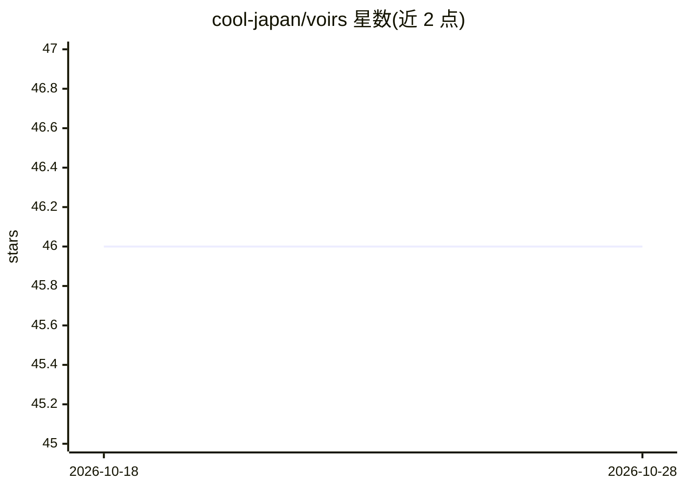

# cool-japan/voirs

⭐ 46 · Rust · NOASSERTION · 推送 2026-09-16 · [GitHub](https://github.com/cool-japan/voirs) · 组织维护

**纯 Rust 实现的神经语音合成（TTS）框架**

VoiRS 是用 Rust 编写的文本转语音框架，整合 cool-japan 生态的 SciRS2/NumRS2/PandRS/TrustformeRS 等 crate，提供 G2P→声学模型→声码器（VITS/FastSpeech2/HiFi-GAN/DiffWave）的模块化管线，支持 SSML、流式合成、多语言 G2P 后端与 Kokoro-82M ONNX 模型（9 语言 54 音色）。支持 DiffWave 声码器训练（SafeTensors 检查点），提供 CLI 与 Rust 库两种使用形式，可选 CUDA/Metal GPU 加速，无 Python 依赖。当前为 0.1.0-beta.1，API 仍可能变化、预训练模型有限。由 COOLJAPAN OU (Team Kitasan) 维护，Apache 2.0 许可。

## 筛选速览

| 维度 | 判定 | 备注 |
|---|---|---|
| AI 角色 | `ai-native` | 本体是模型或模型工具 |
| 许可风险 | `none` | NOASSERTION |
| 部署形态 | `library` | 以包/库形式分发 |
| 模型依赖 | — | README 未给出锁定关系 |
| 硬件要求 | — | 无带数字的原话,不猜 |
| 安装摩擦 | `medium` | 含编译或系统依赖之一 |
| 成熟度 | `idea` | |

## 能力要点

- 纯 Rust 实现，无 Python 依赖，支持 CUDA/Metal/WASM 等多后端
- VITS + HiFi-GAN 核心合成管线与流式低延迟合成
- DiffWave 声码器完整训练管线（SafeTensors 检查点、梯度更新）
- 支持 Kokoro-82M ONNX 模型（9 语言 54 音色）与 SSML

## 适用场景

- 在 Rust 项目中集成文本转语音能力
- 边缘设备/离线场景的实时语音输出
- 用 LJSpeech 等数据集训练自定义 DiffWave 声码器
- 播客、有声书等媒体内容的自动配音生成

## 场景标签

`语音合成` · 领域:内容生成

## 证据(README 行号)

> L9: VoiRS is a cutting-edge Text-to-Speech (TTS) framework that unifies high-performance crates from the cool-japan ecos
> L104: Text Input → G2P → Acoustic Model → Vocoder → Audio Output
> L178: - **Naturalness**: MOS 4.4+ (human evaluation)

## 星数曲线

2026-10-18 46 → 2026-10-28 46（+0）

---
*卡片 v1 · prompt 1.4 · 生成 2026-10-25 · 置信度 high · 依据 README sha `662871040a77` · [字段定义](../../DATASET.md)*
