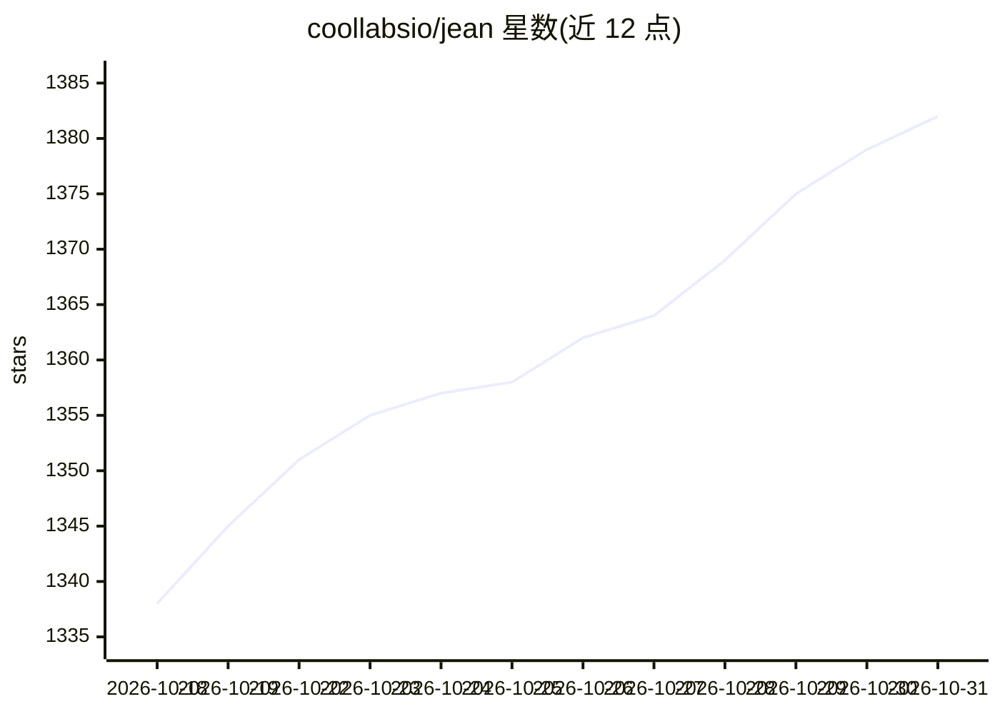

# coollabsio/jean

⭐ 1,382 · TypeScript · Apache-2.0 · 推送 2026-10-30 · [GitHub](https://github.com/coollabsio/jean) · [官网](https://jean.build) · 个人维护

**AI agent 开发环境：并行运行多家 CLI agent 于独立 worktree**

基于 Tauri v2/React/Rust 的桌面与服务器端 AI agent 工作区：让 Claude、Codex、Cursor CLI、OpenCode、Grok、Kimi Code 等多家 agent 并行运行，每个任务拥有独立 git worktree。提供会话管理、diff 审查、内置终端、GitHub/Linear/Sentry 集成、issue 自动建 worktree 并起草执行计划的 Mr. Robot（beta），以及可经浏览器访问的 jean-server 无头模式（Linux amd64/arm64，systemd 安装脚本，Docker 镜像）。使用用户自有 CLI 与订阅，宣称无厂商锁定。macOS 已测试，Windows 未完全测试。

## 筛选速览

| 维度 | 判定 | 备注 |
|---|---|---|
| AI 角色 | `ai-ecosystem` | LLM/agent 周边工具 |
| 许可风险 | `permissive` | Apache-2.0 |
| 部署形态 | `desktop` | 安装包/桌面程序 |
| 模型依赖 | locked-api |  |
| 硬件要求 | — | 无带数字的原话,不猜 |
| 安装摩擦 | `low` | 无编译、无系统依赖或容器化 |
| 成熟度 | `idea` | |

## 能力要点

- 多 agent 并行运行，每任务独立 git worktree，支持自动创建/归档/恢复
- Magic Commands：issue/PR 调查、AI 提交信息、PR 内容与发布说明生成、冲突解决
- GitHub/Linear/Sentry/CodeRabbit 集成，可从 issue/PR 起始会话
- 桌面端 + 无头 jean-server + HTTP/WebSocket Web Access（token 认证，支持手机浏览器）

## 适用场景

- 在同一界面并行管理多个 AI agent 的编码任务与各自 worktree
- 在自有服务器部署 jean-server 远程运行 agent 并经浏览器访问
- 从 GitHub issue/PR 或 Linear/Sentry 事件直接发起 agent 会话

## 场景标签

`多智能体` `编码 Agent` · 领域:Agent 开发

## 证据(README 行号)

> L3: A dev environment for AI agents. Run Claude, Codex, Cursor, OpenCode, Pi, Command Code, Grok, Kimi Code, Antigravity
> L9: Jean is an opinionated AI agent workspace. It has strong opinions about how AI-assisted development should work: eve
> L34: - **AI Backends** - Claude, Codex, Cursor, OpenCode, Pi, Command Code, Grok, Kimi Code, Antigravity (beta), and Mus

## 星数曲线

2026-10-18 1,338 → 2026-10-31 1,382（+44）

---
*卡片 v1 · prompt 1.4 · 生成 2026-10-21 · 置信度 high · 依据 README sha `30a16a5761b1` · [字段定义](../../DATASET.md)*
