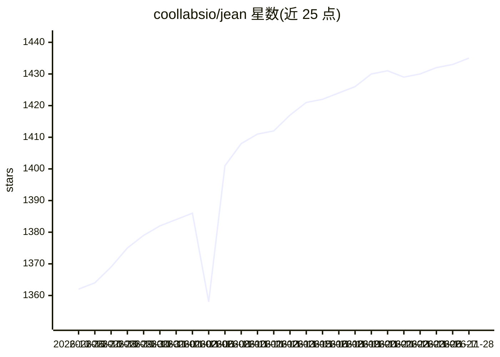

# coollabsio/jean

⭐ 1,435 · TypeScript · Apache-2.0 · 推送 2026-11-27 · [GitHub](https://github.com/coollabsio/jean) · [官网](https://jean.build) · 组织维护

**给 AI 编码 Agent 用的开发环境：并行运行多个 Agent 于独立 git worktree**

Jean 是一个面向 AI Agent 的工作区：为每个任务自动创建独立 git worktree，支持在同一界面并行运行 Claude、Codex、Cursor、OpenCode、Grok、Kimi Code 等多个 CLI Agent，并集成 GitHub（Issues/PR/安全告警）、Linear、Sentry 与终端、diff 审查、diff 行评论等工具。提供 macOS 桌面应用与 Linux 无头服务器（jean-server）两种形态，可通过 Web Access 在浏览器或手机访问。Agent 使用用户自有的 CLI 安装与订阅，运行在用户控制的机器上。

## 筛选速览

| 维度 | 判定 | 备注 |
|---|---|---|
| AI 角色 | `ai-ecosystem` | LLM/agent 周边工具 |
| 许可风险 | `permissive` | Apache-2.0 |
| 部署形态 | `desktop` | 安装包/桌面程序 |
| 模型依赖 | — | README 未给出锁定关系 |
| 硬件要求 | — | 无带数字的原话,不猜 |
| 安装摩擦 | `low` | 无编译、无系统依赖或容器化 |
| 成熟度 | — | 结构信号不足 |

## 能力要点

- 每个任务一个 git worktree，多 Agent 并行会话与 recap/digest
- AI 后端可选 Claude、Codex、Cursor、OpenCode、Grok、Kimi Code 等，含模型选择与 MCP 支持
- GitHub/Linear/Sentry/CodeRabbit 集成，可从 issue/PR 起始会话
- 桌面应用 + 无头服务器双形态，Web Access 支持 token 认证与远程访问

## 适用场景

- 并行跑多个 AI 编码任务且互不冲突（每个任务独立 worktree）
- 在远程 Linux 服务器上集中运行 Agent，通过浏览器操作
- 从 GitHub issue/PR 或 Linear/Sentry 条目发起代码调查与修复

## 场景标签

`编码 Agent` · 领域:编码与开发

## 证据(README 行号)

> L3: A dev environment for AI agents. Run Claude, Codex, Cursor, OpenCode, Pi, Command Code, Grok, Kimi Code, Antigravity
> L9: Jean is an opinionated AI agent workspace. It has strong opinions about how AI-assisted development should work: eve
> L34: - **AI Backends** - Claude, Codex, Cursor, OpenCode, Pi, Command Code, Grok, Kimi Code, Antigravity (beta), and Mus

## 星数曲线

2026-10-26 1,362 → 2026-11-28 1,435（+73）

---
*卡片 v1 · prompt 1.4 · 生成 2026-11-23 · 置信度 high · 依据 README sha `00193e9d423a` · [字段定义](../../DATASET.md)*
