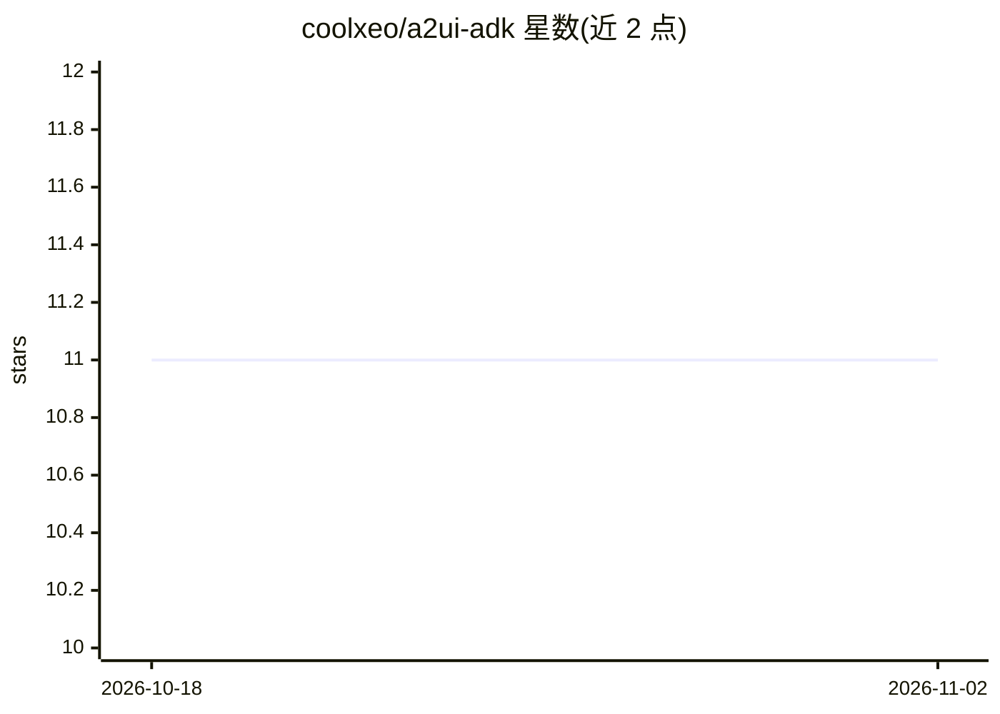

# coolxeo/a2ui-adk

⭐ 11 · 推送 2026-03-07 · [GitHub](https://github.com/coolxeo/a2ui-adk) · 个人维护

**面向 AI 编码代理的技能：构建带 A2UI 声明式 UI 的 Google ADK agent**

一个 agent skill 包，安装后在 Claude Code、Cursor、Windsurf、Cline 等 AI 编码代理会话中提供 A2UI + Google ADK 开发的上下文知识：涵盖 A2uiSchemaManager、流式校验重试、A2A 服务器托管等模式，内置 Tailwind CSS + shadcn/ui 设计系统、自定义组件目录 JSON schema、联系卡片/仪表盘/预订表单等模板，以及多 agent UI 路由的编排器模式。通过 npx skills add 一条命令安装，卸载时删除技能目录即可。

## 筛选速览

| 维度 | 判定 | 备注 |
|---|---|---|
| AI 角色 | `ai-ecosystem` | LLM/agent 周边工具 |
| 许可风险 | `none` | — |
| 部署形态 | `library` | 以包/库形式分发 |
| 模型依赖 | — | README 未给出锁定关系 |
| 硬件要求 | — | 无带数字的原话,不猜 |
| 安装摩擦 | `low` | 无编译、无系统依赖或容器化 |
| 成熟度 | — | 结构信号不足 |

## 能力要点

- 提供 A2UI + ADK 模式上下文（A2uiSchemaManager、流式校验、A2A 托管）
- 内置 Tailwind + shadcn/ui 设计系统与自定义组件目录 schema
- 含单 agent 与多 agent 编排器两种模式
- 附联系卡片、仪表盘指标、预订表单示例模板

## 适用场景

- 让 AI 编码代理构建带交互式 UI 的 ADK agent
- 为现有 ADK agent 添加 A2UI 支持
- 构建路由到多个 A2UI 子 agent 的编排器

## 场景标签

`多智能体` · 领域:Agent 开发

## 证据(README 行号)

> L3: An agent skill for building Google ADK agents with A2UI — the declarative JSON format that lets agents generate rich
> L5: Works with **Claude Code**, **Cursor**, **Windsurf**, **Cline**, and any AI coding agent that supports the skills ec

## 星数曲线

2026-10-18 11 → 2026-11-02 11（+0）

---
*卡片 v1 · prompt 1.4 · 生成 2026-11-02 · 置信度 high · 依据 README sha `2bb07b27a847` · [字段定义](../../DATASET.md)*
