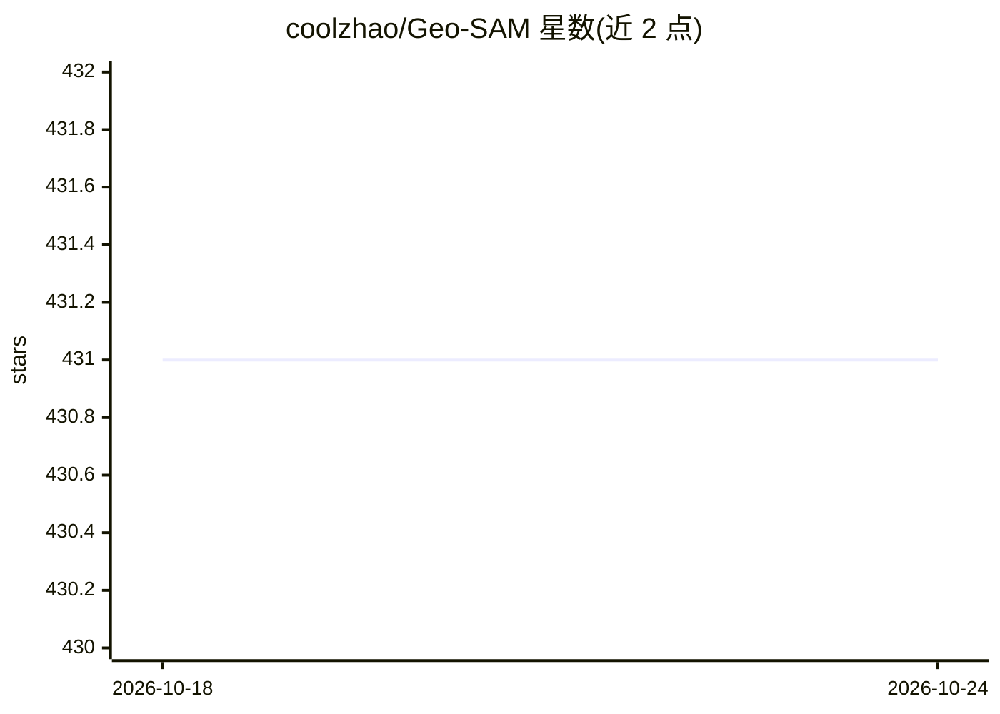

# coolzhao/Geo-SAM

⭐ 431 · Python · MIT · 推送 2026-07-07 · [GitHub](https://github.com/coolzhao/Geo-SAM) · [官网](https://geo-sam.readthedocs.io/en/latest/) · 组织维护 · 中文 README

**QGIS 插件：用 SAM 加速遥感影像中地貌的交互式分割标注**

QGIS 插件，基于 Segment Anything Model（支持 SAM、SAM 2、SAM 2.1、SAM 3 模型族）对大型地理空间栅格影像中的地貌进行分割、勾绘与标注。通过预先编码图像特征并在推理时剥离重量级图像编码器，交互式分割可在笔记本 CPU 上以毫秒级速度运行。v2.0 提供 Live Encoding（即时编码）与 Pre-encoded（预编码）两种工作流，附带 XYZ/WMS 在线瓦片图层分割、矢量化输出、多语言界面等特性。已上架 QGIS 官方插件仓库。

## 筛选速览

| 维度 | 判定 | 备注 |
|---|---|---|
| AI 角色 | `ai-native` | 本体是模型或模型工具 |
| 许可风险 | `permissive` | MIT |
| 部署形态 | `None` |  |
| 模型依赖 | — | README 未给出锁定关系 |
| 硬件要求 | — | 无带数字的原话,不猜 |
| 安装摩擦 | `low` | 无编译、无系统依赖或容器化 |
| 成熟度 | — | 结构信号不足 |

## 能力要点

- 预编码图像特征实现笔记本 CPU 上毫秒级交互分割
- 支持 SAM / SAM 2 / SAM 2.1 / SAM 3 模型族
- Live Encoding 与 Pre-encoded 两种分割工作流
- 支持 XYZ/WMS 在线瓦片图层与多语言界面

## 适用场景

- 在遥感影像中高效勾绘与标注地貌边界
- 对同一影像重复分割时复用预编码特征文件
- 直接对在线瓦片图层进行分割

## 场景标签

`目标检测` · 领域:感知与多模态

## 证据(README 行号)

> L14: Geo-SAM is a QGIS plugin that helps you segment, delineate, and label
> L16: Segment Anything Model (SAM) and uses the
> L40: - **SAM3 model support** -- SAM, SAM 2, SAM 2.1, and SAM 3 model families.

## 星数曲线

2026-10-18 431 → 2026-10-24 431（+0）

---
*卡片 v1 · prompt 1.4 · 生成 2026-10-21 · 置信度 high · 依据 README sha `90b6fec8d7b9` · [字段定义](../../DATASET.md)*
