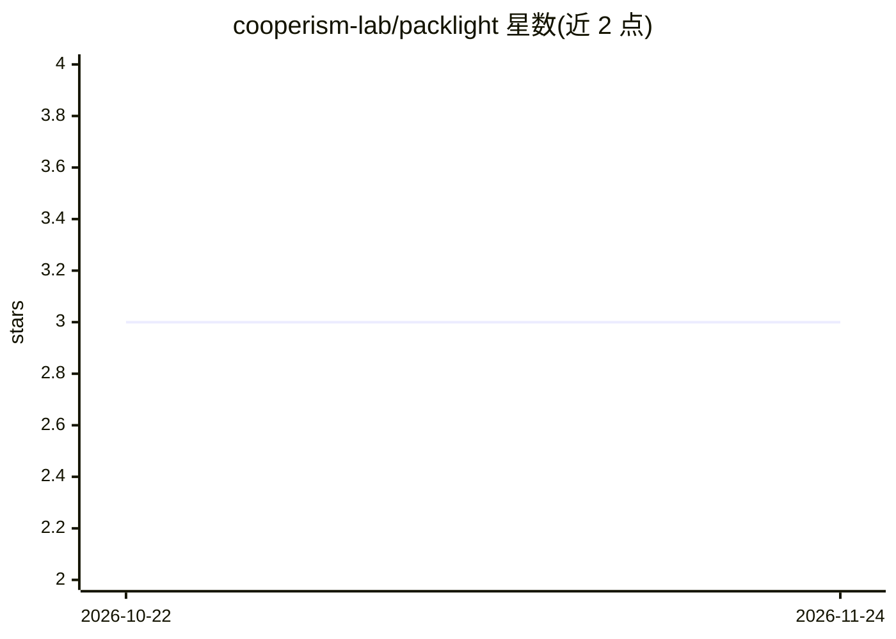

# cooperism-lab/packlight

⭐ — · [GitHub]() · 个人维护 · 中文 README

**审计 Claude Code/Codex 会话上下文占用并归档未用项的 CLI**

本地运行的 CLI 工具：扫描 Claude Code 或 Codex 的安装配置与会话日志，生成一份自包含报告，展示每个会话按来源（MCP 工具名、技能列表、hook 文本、agent 描述）统计的起始 token 数、被挤出技能列表的技能、各 hook 注入的文本量，以及安装以来从未被使用的条目。用户标记后用 packlight apply 可逆归档，restore 可按字节还原并带崩溃安全日志；packlight fix 可按未使用判定（≥20 会话且 14 天）一键生成归档计划。需要 Node 20+，全部本地运行、无遥测与网络调用。

## 筛选速览

| 维度 | 判定 | 备注 |
|---|---|---|
| AI 角色 | `ai-ecosystem` | LLM/agent 周边工具 |
| 许可风险 | `permissive` | — |
| 部署形态 | `library` | 以包/库形式分发 |
| 模型依赖 | — | README 未给出锁定关系 |
| 硬件要求 | — | 无带数字的原话,不猜 |
| 安装摩擦 | `low` | 无编译、无系统依赖或容器化 |
| 成熟度 | `idea` | |

## 能力要点

- 按来源拆分统计每个会话的起始 token 占用
- 识别从未被使用的技能/hook/MCP 项，支持可逆归档与还原
- 自动检测 Claude Code（~/.claude 存在时），Codex 需 --agent codex 参数
- 纯本地运行，无遥测与网络调用

## 适用场景

- 排查 Claude Code 会话上下文被哪些 MCP 工具和技能占满
- 归档长期未使用的技能与 hook 以减少注入文本
- 切换到 Codex 后生成对应的上下文审计报告

## 场景标签

`LLM 可观测性` · 领域:评测与运维

## 证据(README 行号)

> L5: Claude Code loads every skill, agent, hook and MCP server you have installed into every session, used or not. packli
> L12: Works with **Claude Code** and **Codex**. packlight picks Claude Code when `~/.claude` exists; for Codex, add `--ag
> L18: Everything runs locally: no telemetry, and no network calls from the CLI or the report.

## 星数曲线

2026-10-22 3 → 2026-11-24 3（+0）

---
*卡片 v1 · prompt 1.4 · 生成 2026-11-22 · 置信度 high · 依据 README sha `44df0a5810e7` · [字段定义](../../DATASET.md)*
