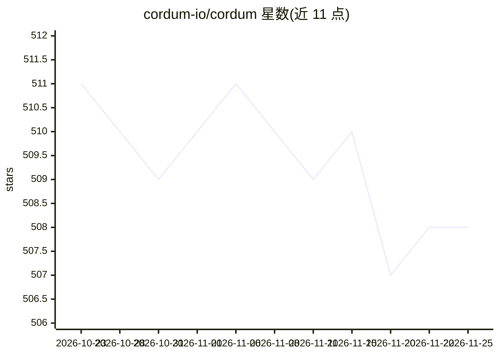

# cordum-io/cordum

⭐ 508 · Go · NOASSERTION · 推送 2026-11-19 · [GitHub](https://github.com/cordum-io/cordum) · 组织维护

**AI agent 动作管控平面：风险工具调用前执行策略与人工审批**

以 Source-Available 形式提供的 agent 控制平面：在 agent 动作派发边界处做策略判定，支持 ALLOW/DENY/REQUIRE_APPROVAL/THROTTLE/ALLOW_WITH_CONSTRAINTS 五种裁决，动作规范化后以 SHA-256 哈希绑定审批，审批需租户、approval_ref 与 action_hash 匹配。组件含 API 网关、调度器、Safety Kernel、工作流引擎、上下文引擎、仪表盘与 MCP 服务，用 YAML 声明策略，默认未匹配请求为 deny。Cordum Edge 以 hook 方式对 Claude Code 工具调用做元数据导出的策略评估。部署路径含源码脚本、docker compose、手动 go run 与 Helm。

## 筛选速览

| 维度 | 判定 | 备注 |
|---|---|---|
| AI 角色 | `ai-ecosystem` | LLM/agent 周边工具 |
| 许可风险 | `none` | NOASSERTION |
| 部署形态 | `self-host` | docker 或自建部署 |
| 模型依赖 | — | README 未给出锁定关系 |
| 硬件要求 | — | 无带数字的原话,不猜 |
| 安装摩擦 | `low` | 无编译、无系统依赖或容器化 |
| 成熟度 | — | 结构信号不足 |

## 能力要点

- 五种显式裁决，未知裁决一律转为 DENY
- SHA-256 哈希绑定审批，拒绝自批、过期与已消费的审批
- 声明式 YAML 策略按租户、topic、能力、风险标签、actor 匹配
- Cordum Edge 通过 cordumctl edge claude 对 Claude Code 工具调用做 hook 策略检查

## 适用场景

- 在 agent 执行 shell 命令或生产变更前强制策略与人工审批
- 对敏感 agent 动作保留可审计的审批证据
- 为编码类 agent（Claude Code）接入本地派发前策略检查

## 场景标签

`Agent 框架` · 领域:Agent 开发

## 证据(README 行号)

> L8:  The Source-Available Agent Control Plane for policy checks, approvals, and audit of the agent actions it mediates.
> L261: Cordum puts a policy decision at that dispatch boundary:
> L279: - **Cordum Edge.** A local hook evaluates coding-agent tool calls (Claude Code

## 星数曲线

2026-10-23 511 → 2026-11-25 508（-3）

---
*卡片 v1 · prompt 1.4 · 生成 2026-11-25 · 置信度 mid · 依据 README sha `f09eac9b4a40` · [字段定义](../../DATASET.md)*
