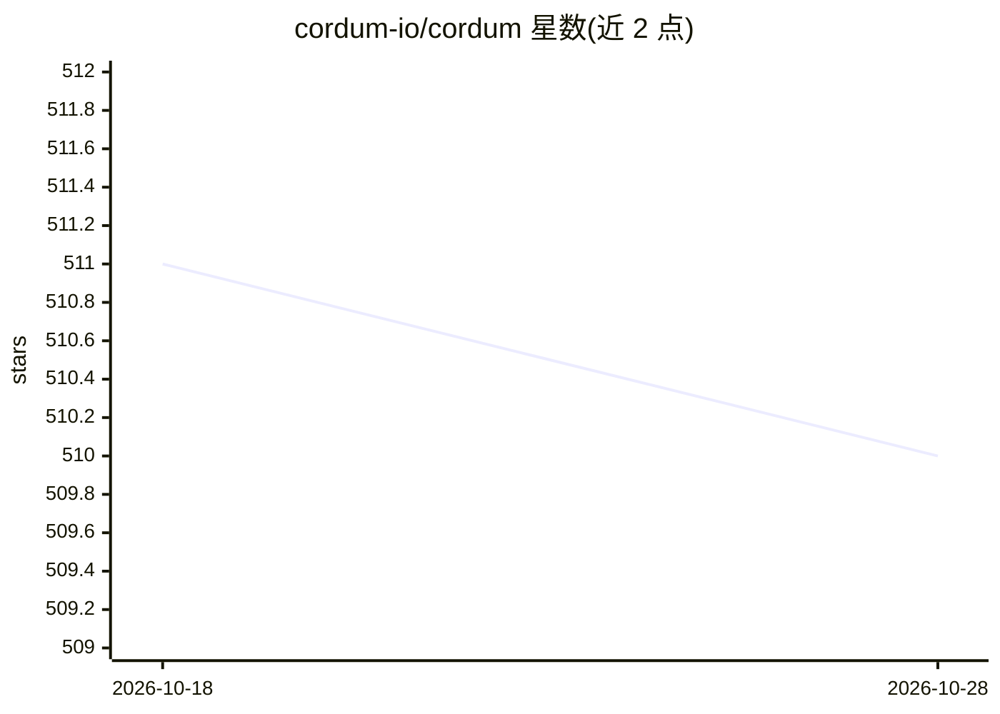

# cordum-io/cordum

⭐ 510 · Go · NOASSERTION · 推送 2026-10-28 · [GitHub](https://github.com/cordum-io/cordum) · 组织维护

**AI agent 治理控制平面：在风险操作前强制策略与人工审批**

面向自主 AI agent 的治理与安全控制平面：在 agent 执行前评估声明式策略、由 safety kernel 拦截风险操作、执行中提供实时可见性与步骤级审批及超时/熔断、事后聚合审计证据。以 Docker Compose 一键部署的全栈（网关、调度器、safety kernel、工作流引擎、dashboard、NATS、TLS Redis）形式提供，另含 Cordum Edge——通过命令钩子管控 Claude Code 本地工具调用的合规防火墙，支持审批溯源（resolved-only）与脱敏证据导出。也提供 Helm/Kubernetes 部署与 cosign 镜像签名验证。限制：需 Docker 与 Go 1.26.3+；Edge 的 wrapper 为开发者/演示路径，企业级强制需托管配置。

## 筛选速览

| 维度 | 判定 | 备注 |
|---|---|---|
| AI 角色 | `ai-ecosystem` | LLM/agent 周边工具 |
| 许可风险 | `none` | NOASSERTION |
| 部署形态 | `self-host` | docker 或自建部署 |
| 模型依赖 | — | README 未给出锁定关系 |
| 硬件要求 | — | 无带数字的原话,不猜 |
| 安装摩擦 | `low` | 无编译、无系统依赖或容器化 |
| 成熟度 | — | 结构信号不足 |

## 能力要点

- 声明式策略在 agent 执行前评估，safety kernel 拦截风险操作并要求人工审批
- Cordum Edge 为 Claude Code 提供命令钩子合规防火墙：拒绝风险操作、编辑需审批、导出脱敏证据
- 审批溯源为 resolved-only：破坏性重试须匹配已解决的审批审计事件
- Docker Compose / Helm / 手动 go run 三种部署路径，镜像经 cosign keyless 签名

## 适用场景

- 企业在生产部署自主 agent 前拦截危险工具调用与 shell 命令
- 为 Claude Code 等本地 agent 会话添加审批门与审计证据
- 集中管理 agent 集群的策略、审批与审计轨迹

## 场景标签

`LLM 可观测性` · 领域:评测与运维

## 证据(README 行号)

> L261: Cordum is an **Agent Control Plane** that provides a deterministic governance layer for probabilistic AI minds. It
> L283: - **BEFORE (Governance)**: Define declarative policies that evaluate job requests *before* an agent executes. Trig

## 星数曲线

2026-10-18 511 → 2026-10-28 510（-1）

---
*卡片 v1 · prompt 1.4 · 生成 2026-10-21 · 置信度 mid · 依据 README sha `c86fae7318b3` · [字段定义](../../DATASET.md)*
