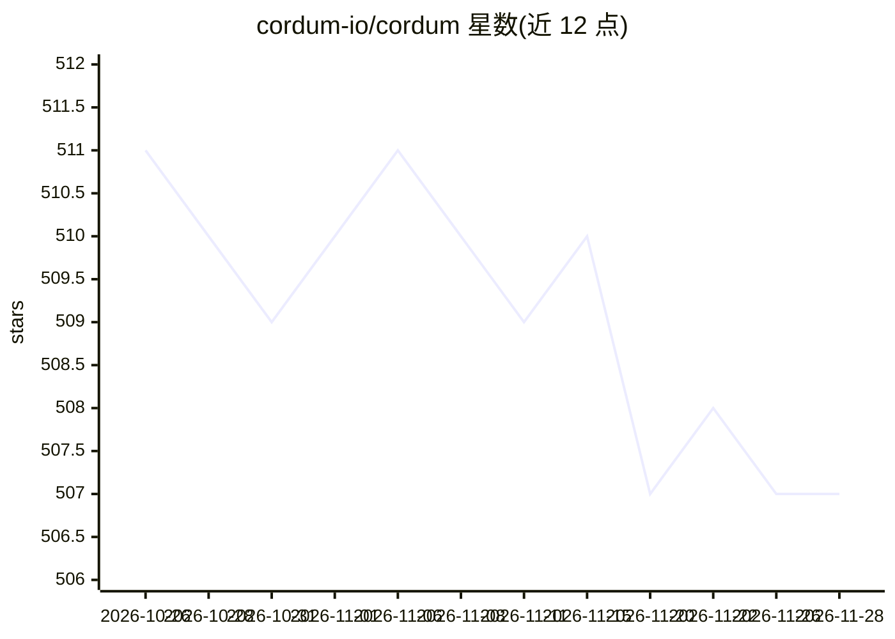

# cordum-io/cordum

⭐ 507 · Go · NOASSERTION · 推送 2026-11-27 · [GitHub](https://github.com/cordum-io/cordum) · 组织维护

**AI Agent 行动的策略防火墙：执行前拦截、审批与审计**

定位为 agent 控制平面：在工具调用、shell 命令、工作流与生产变更被分派前插入策略决策，输出 ALLOW/DENY/REQUIRE_APPROVAL/THROTTLE/ALLOW_WITH_CONSTRAINTS 五种裁决；动作经规范化并以 SHA-256 哈希绑定审批，未匹配请求默认拒绝，通过 CAP/MCP 集成与本地 Edge hook（当前支持 Claude Code）评估请求。组件含 API 网关、调度器、safety kernel、工作流/上下文引擎与仪表盘，以 Docker Compose、Helm 或源码方式部署；agent 风险分级功能需 Enterprise 许可。

## 筛选速览

| 维度 | 判定 | 备注 |
|---|---|---|
| AI 角色 | `ai-ecosystem` | LLM/agent 周边工具 |
| 许可风险 | `none` | NOASSERTION |
| 部署形态 | `self-host` | docker 或自建部署 |
| 模型依赖 | — | README 未给出锁定关系 |
| 硬件要求 | — | 无带数字的原话,不猜 |
| 安装摩擦 | `low` | 无编译、无系统依赖或容器化 |
| 成熟度 | — | 结构信号不足 |

## 能力要点

- 分派边界的策略裁决：五种显式 verdict，未知裁决按 DENY 处理
- SHA-256 action_hash 绑定审批，拒绝自批准/过期/已消费的审批
- 声明式 YAML 策略按 tenant/topic/capability/risk tags 等匹配，默认 deny
- Edge hook 评估 Claude Code 工具调用，导出仅含元数据的会话证据

## 适用场景

- 在 Agent 执行删除、生产变更等敏感操作前强制人工审批
- 为团队建立 Agent 操作的可审计留痕与合规证据
- 通过本地 hook 对编码 Agent 的工具调用做策略检查

## 场景标签

`Agent 框架` · 领域:Agent 开发

## 证据(README 行号)

> L8:  The Source-Available Agent Control Plane for policy checks, approvals, and audit of the agent actions it mediates.
> L261: Cordum puts a policy decision at that dispatch boundary:
> L264:  MCP tool calls (tenant, server, tool, target path) and Cordum Edge evaluate

## 星数曲线

2026-10-26 511 → 2026-11-28 507（-4）

---
*卡片 v1 · prompt 1.4 · 生成 2026-11-27 · 置信度 mid · 依据 README sha `d6e5843b05ad` · [字段定义](../../DATASET.md)*
