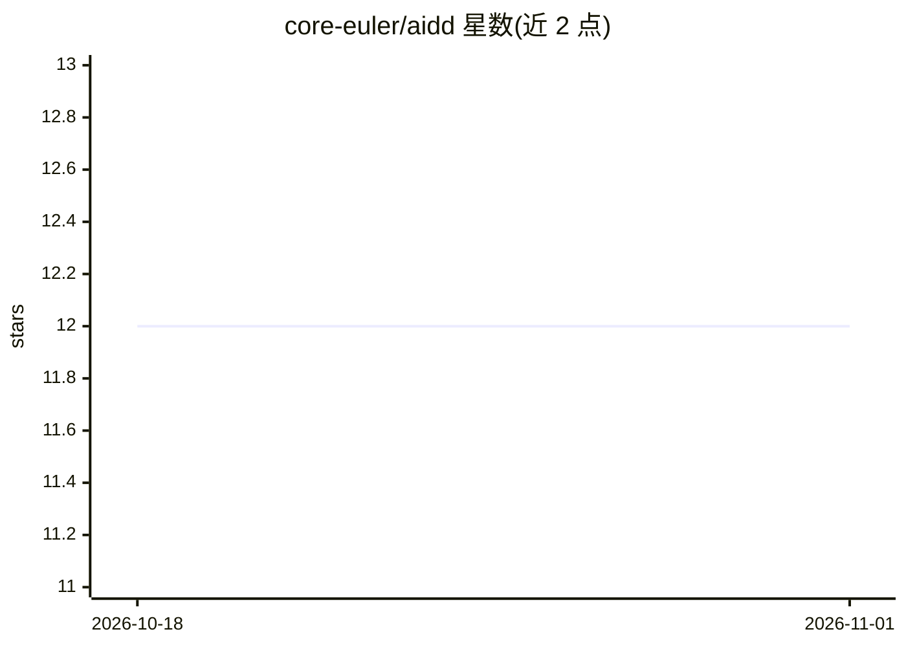

# core-euler/aidd

⭐ 12 · 推送 2026-05-09 · [GitHub](https://github.com/core-euler/aidd) · 个人维护 · 中文 README

**LLM 驱动开发方法论：以文档而非代码为核心交付物**

一套以文档为主制品的软件开发方法论：开发者撰写规格说明与测试，由 LLM 据此生成代码，代码成为文档的派生物，可在丢失后复现。仓库提供方法手册、复现提示词、可复现性概念文档，以及基于 aiogram 的 GameTODO Bot 演示项目（含 SPEC/DNA/TEST_CONTRACT 等文档，docker-compose up 运行）。限定具备架构能力且会使用 LLM 的工程师，明确 LLM 是放大器而非替代，人需掌控架构与业务逻辑。

## 筛选速览

| 维度 | 判定 | 备注 |
|---|---|---|
| AI 角色 | `ai-knowledge` | 知识聚合/清单类 |
| 许可风险 | `none` | — |
| 部署形态 | `self-host` | docker 或自建部署 |
| 模型依赖 | — | README 未给出锁定关系 |
| 硬件要求 | — | 无带数字的原话,不猜 |
| 安装摩擦 | `low` | 无编译、无系统依赖或容器化 |
| 成熟度 | — | 结构信号不足 |

## 能力要点

- 文档+测试先行、LLM 生成代码的工作流
- 四级可复现性评定（0-2 次迭代为可复现）
- 含 .claude/ 本地代理、规则与命令模板
- demo/ 提供仅凭文档即可复现的完整示例项目

## 适用场景

- 按该方法论组织以文档为中心的开发流程
- 参照 demo 项目的文档结构搭建可复现工程
- 获取用于 LLM 代码生成的提示词与规则模板

## 场景标签

`代码生成` `教程课程` · 领域:编码与开发

## 证据(README 行号)

> L3: Методология разработки программного обеспечения, где главным артефактом является не код, а документация. Код генерир
> L42: ├── method.md               # Методичка LLM‑Driven разработки

## 星数曲线

2026-10-18 12 → 2026-11-01 12（+0）

---
*卡片 v1 · prompt 1.4 · 生成 2026-11-01 · 置信度 high · 依据 README sha `51249863c225` · [字段定义](../../DATASET.md)*
