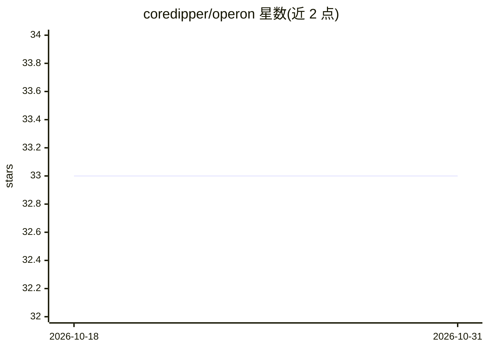

# coredipper/operon

⭐ 33 · Python · MIT · 推送 2026-07-07 · [GitHub](https://github.com/coredipper/operon) · [官网](https://pypi.org/project/operon-ai/) · 个人维护

**面向 AI agent 系统的生物学启发控制模式库**

研究级 Python 库，提供可验证结构保证的 agent 控制构建块：reviewer gates、specialist swarms、skill organisms、managed_organism 等 Pattern-First API，并保留底层接线与分析层。核心机制包括：Certificate（定理名+verify_fn 外部复验）、ApprovalToken 双密钥执行、advise_topology 在运行前分析接线图风险（可观测性/路由成本/收敛深度）、双时态记忆（valid time 与 record time）。biological 母题（基因调控网络、免疫系统、代谢优先级门控、群体感应）被具体实现。通过 convergence 包适配 6 个外部 agent 框架（Swarms/DeerFlow/AnimaWorks/Ralph/A-Evolve/Scion）至统一 IR，证书可跨框架经 A2A parts 传输，并可编译到 LangGraph。自述 API 仍在演进。

## 筛选速览

| 维度 | 判定 | 备注 |
|---|---|---|
| AI 角色 | `ai-ecosystem` | LLM/agent 周边工具 |
| 许可风险 | `permissive` | MIT |
| 部署形态 | `library` | 以包/库形式分发 |
| 模型依赖 | — | README 未给出锁定关系 |
| 硬件要求 | — | 无带数字的原话,不猜 |
| 安装摩擦 | `low` | 无编译、无系统依赖或容器化 |
| 成熟度 | `idea` | |

## 能力要点

- Certificate/ApprovalToken 机制：结构保证以可外部复验的证明工件形式存在
- advise_topology 在运行前分析接线图风险（可观测性、路由成本、收敛深度）
- 适配 6 个外部 agent 框架至统一 IR，证书经 A2A parts 跨框架传输
- 双时态记忆支持信念状态重建（“stage X 决策时系统知道什么”）

## 适用场景

- 为多 agent 流水线添加带外部复验的审查门控
- 在运行前评估 agent 接线拓扑的风险画像
- 把现有 Swarms/LangGraph 等框架的 agent 结构纳入统一分析并跨框架迁移
- 需要可审计决策依据的 agent 工作流（双时态记忆）

## 场景标签

`Agent 框架` `多智能体` · 领域:Agent 开发

## 证据(README 行号)

> L20: Operon is a library for making that structure explicit. It gives you pattern-first building blocks like reviewer ga
> L28: - **Framework-neutral by design.** `operon_ai.convergence` adapts six external agent frameworks (Swarms, DeerFlow, 

## 星数曲线

2026-10-18 33 → 2026-10-31 33（+0）

---
*卡片 v1 · prompt 1.4 · 生成 2026-10-25 · 置信度 high · 依据 README sha `a63fa47251da` · [字段定义](../../DATASET.md)*
