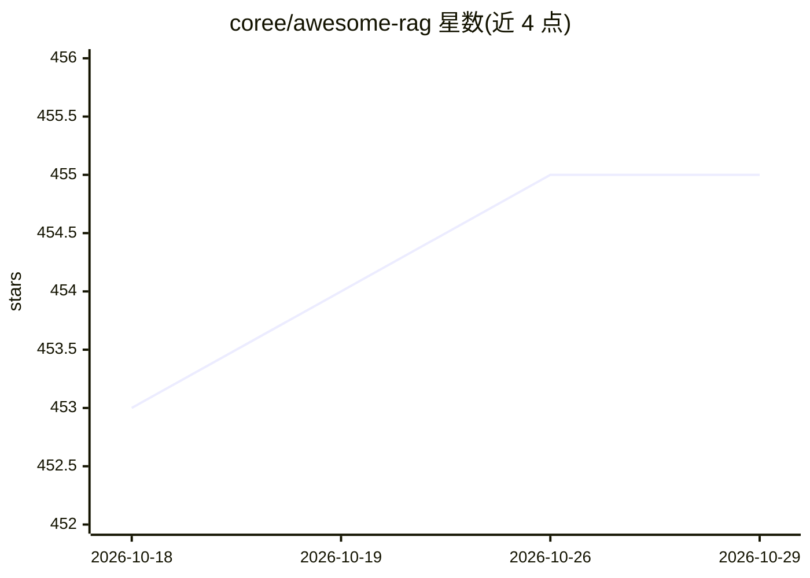

# coree/awesome-rag

⭐ 455 · CC0-1.0 · 推送 2025-12-01 · [GitHub](https://github.com/coree/awesome-rag) · 个人维护

**RAG 论文与工具的策展清单：面向 LLM 检索增强生成研究者**

 awesome 风格的检索增强生成（RAG）资源清单，按论文（综述与一般研究，2020-2024，含 Paper/Code/arXiv 等链接标签）、教程讲座、研讨会、工具（LangChain/LlamaIndex/Verba 等）及同类清单分节组织。面向 LLM 研究者与开发者查找 RAG 论文和方法资料。仓库本身为纯列表，无可安装代码。

## 筛选速览

| 维度 | 判定 | 备注 |
|---|---|---|
| AI 角色 | `ai-knowledge` | 知识聚合/清单类 |
| 许可风险 | `viral` | CC0-1.0 |
| 部署形态 | `None` |  |
| 模型依赖 | — | README 未给出锁定关系 |
| 硬件要求 | — | 无带数字的原话,不猜 |
| 安装摩擦 | `low` | 无编译、无系统依赖或容器化 |
| 成熟度 | — | 结构信号不足 |

## 能力要点

- 按年份（2020-2024）组织 RAG 综述与研究论文条目
- 覆盖讲座、教程与研讨会（ACL/NeurIPS/EMNLP 等 venue）
- 收录 7 个 RAG 相关工具与 5 个同类清单

## 适用场景

- 查找 RAG 领域的综述与研究论文
- 发现 RAG 框架与工具（LangChain、LlamaIndex 等）
- 追踪 RAG 相关教程与研讨会资源

## 场景标签

`精选清单` · 领域:学习与行业

## 证据(README 行号)

> L2: A curated list of retrieval-augmented generation (RAG) in large language models.
> L10: ## Papers
> L191: ## Tools

## 星数曲线

2026-10-18 453 → 2026-10-29 455（+2）

---
*卡片 v1 · prompt 1.4 · 生成 2026-10-21 · 置信度 high · 依据 README sha `e81907fb516d` · [字段定义](../../DATASET.md)*
