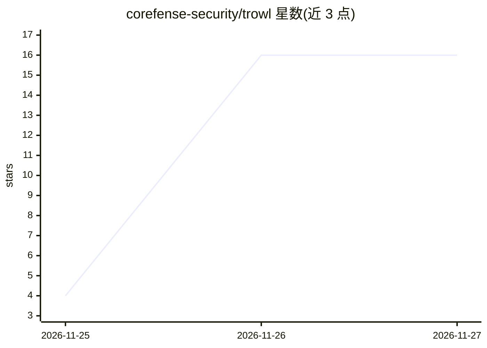

# corefense-security/trowl

⭐ 16 · Go · Apache-2.0 · 推送 2026-11-24 · [GitHub](https://github.com/corefense-security/trowl) · 组织维护

**为嵌入式 Linux 镜像扫描安全加固缺口、CVE 与 SBOM 差异**

Trowl 是面向嵌入式 Linux 镜像的构建后安全扫描器：解包镜像后检查内核与用户态的加固缺口、配置错误与已知 CVE，并比对 SBOM 与镜像实际内容；配合内核源码可为内核 CVE 生成 VEX 状态。支持 Yocto/Buildroot 目标、多种文件系统与压缩格式、SPDX/CycloneDX SBOM。报告输出 HTML/JSON/OpenVEX。可选启用本地 LLM（Qwen 系列权重，从 Hugging Face 下载）生成影响摘要；扫描数据来自 NVD/OSV/CISA KEV 等外部源。提供 Docker 与 Debian/Ubuntu 安装脚本，镜像经 Cosign 签名。

## 筛选速览

| 维度 | 判定 | 备注 |
|---|---|---|
| AI 角色 | `ai-enhanced` | 去掉 AI 部分产品仍成立 |
| 许可风险 | `permissive` | Apache-2.0 |
| 部署形态 | `self-host` | docker 或自建部署 |
| 模型依赖 | — | README 未给出锁定关系 |
| 硬件要求 | — | 无带数字的原话,不猜 |
| 安装摩擦 | `low` | 无编译、无系统依赖或容器化 |
| 成熟度 | `idea` | |

## 能力要点

- 解包镜像检查内核/用户态加固缺口、密钥泄露与 CVE
- SBOM 与镜像内容比对，标注 VEX 分歧
- 支持 SPDX 2.2/3.0 与 CycloneDX JSON SBOM
- 可选本地 LLM（Qwen 权重）生成影响摘要

## 适用场景

- 扫描 Yocto/Buildroot 产出镜像的加固与配置缺口
- 比对 SBOM 声明与镜像实际交付物
- 为内核 CVE 生成 VEX 状态与报告

## 场景标签

`网络安全` · 领域:学习与行业

## 证据(README 行号)

> L8: Trowl is a post-build security scanner for embedded Linux images. It unpacks the image and checks the kernel and use
> L30: ### Local LLM (experimental)
> L32: Trowl uses local LLM to generate impact summaries. Model weights are downloaded from Hugging Face.

## 星数曲线

2026-11-25 4 → 2026-11-27 16（+12）

---
*卡片 v1 · prompt 1.4 · 生成 2026-11-24 · 置信度 high · 依据 README sha `583348deb17b` · [字段定义](../../DATASET.md)*
