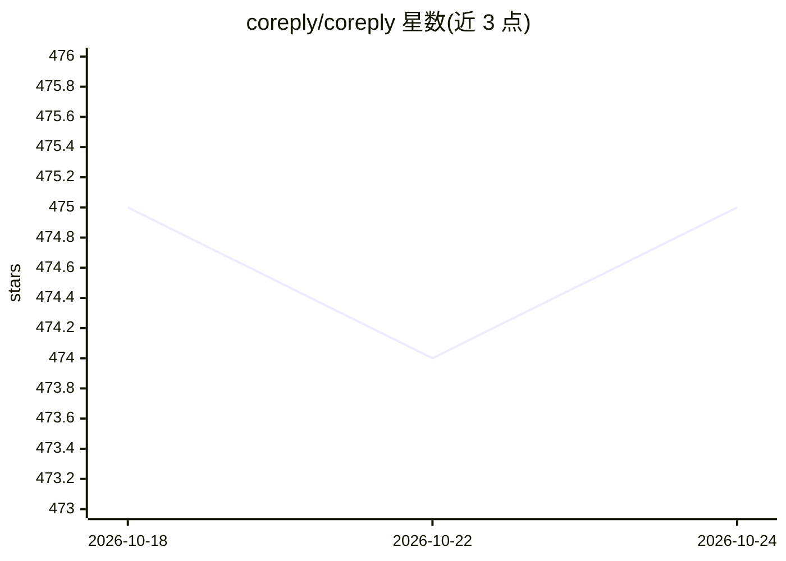

# coreply/coreply

⭐ 474 · TypeScript · AGPL-3.0 · 推送 2026-09-28 · [GitHub](https://github.com/coreply/coreply) · [官网](https://coreply.app) · 组织维护

**在聊天应用中边打字边给出 AI 续写建议的 Android 应用**

开源 Android 应用，在 20 余种通讯应用（WhatsApp、Telegram、Signal、Discord 等）中实时读取打字上下文，通过 LLM 生成续写建议：单击插入单词、长按插入整句。推理依赖外部服务：支持任意 OpenAI 兼容 API，或注册 Coreply Cloud 使用托管版；官方列出 Google AI Studio、Groq、OpenRouter、OpenAI、Mistral 等提供商。流量直连推理 API，不经中间服务器（托管版除外）。要求 Android 8+，通过 APK/Google Play/Obtainium 分发，亦可 Android Studio 源码构建。已知限制：无法读取图片/语音等非文本内容，RTL 支持有限。

## 筛选速览

| 维度 | 判定 | 备注 |
|---|---|---|
| AI 角色 | `ai-native` | 本体是模型或模型工具 |
| 许可风险 | `viral` | AGPL-3.0 |
| 部署形态 | `desktop` | 安装包/桌面程序 |
| 模型依赖 | locked-api |  |
| 硬件要求 | — | 无带数字的原话,不猜 |
| 安装摩擦 | `low` | 无编译、无系统依赖或容器化 |
| 成熟度 | — | 结构信号不足 |

## 能力要点

- 在 20+ 通讯应用中提供实时上下文续写建议（单击插词/长按插整句）
- 支持任意 OpenAI 兼容 API 的自定义 LLM 设置
- 流量直连推理 API，不经中间服务器（托管版除外）
- 支持 Coreply Cloud 托管版或第三方提供商（Groq/OpenRouter 等）

## 适用场景

- 在日常聊天中边打字边获得 AI 补全建议
- 自带 API key 接入自选的 LLM 推理服务
- 在不切换输入法的情况下跨多个聊天应用使用建议

## 场景标签

`AI 助手` · 领域:对话与助手

## 证据(README 行号)

> L9: **Coreply** is an open-source Android app providing texting suggestions while you type. It enhances
> L58: - **Real-time AI Suggestions**: Get accurate, context-aware suggestions as you type.
> L59: - **Customizable LLM Settings**: Supports any inference service having an OpenAI compatible API.

## 星数曲线

2026-10-18 475 → 2026-10-24 475（+0）

---
*卡片 v1 · prompt 1.4 · 生成 2026-10-21 · 置信度 high · 依据 README sha `710f19bccc0e` · [字段定义](../../DATASET.md)*
