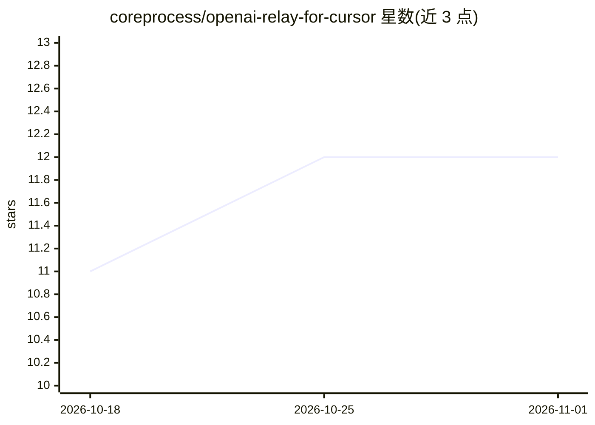

# coreprocess/openai-relay-for-cursor

⭐ 12 · TypeScript · 推送 2026-09-06 · [GitHub](https://github.com/coreprocess/openai-relay-for-cursor) · 个人维护

**本地中继：让 Cursor 用自己的 key 调用 Responses-API 专属 OpenAI 模型**

运行在本机的 Node.js 中继服务：把 Cursor BYOK 发出的 Chat Completions 请求翻译为 OpenAI Responses API 调用并转换回 SSE 流，从而在 Cursor Agent 中使用 gpt-6-astra 等仅支持 Responses API 的模型。内置 ngrok 隧道提供公网 HTTPS 端点；真实 OpenAI key 仅存于本机 .env，Cursor 侧只使用随机 relay token。支持模型别名（relay-前缀携带 reasoning effort）、诊断日志（LOG_BODIES）、自带隧道或纯本地运行，也支持 Cloudflare named tunnel 与 Tailscale Funnel。面向使用 Cursor 且持有 OpenAI API key 的开发者。

## 筛选速览

| 维度 | 判定 | 备注 |
|---|---|---|
| AI 角色 | `ai-ecosystem` | LLM/agent 周边工具 |
| 许可风险 | `none` | — |
| 部署形态 | `library` | 以包/库形式分发 |
| 模型依赖 | — | README 未给出锁定关系 |
| 硬件要求 | — | 无带数字的原话,不猜 |
| 安装摩擦 | `low` | 无编译、无系统依赖或容器化 |
| 成熟度 | — | 结构信号不足 |

## 能力要点

- Chat Completions ↔ Responses API 双向协议翻译（含工具调用、流式 chunk 转换）
- relay-<model>-<effort> 别名机制映射真实模型与 reasoning effort
- 内置 ngrok 隧道，单个 pnpm start 即得公网 HTTPS 端点
- LOG_BODIES=1 输出四类每请求诊断文件（请求/响应/上/下行）

## 适用场景

- 在 Cursor Agent 里用自己的 OpenAI key 运行 gpt-6-astra
- 让 OpenAI key 保留在本机、Cursor 侧仅使用可轮换的 relay token
- 调试查看 Cursor 实际发送与接收的请求内容
- 换用自带隧道（Cloudflare named / Tailscale Funnel）或纯本地部署

## 场景标签

 · 领域:LLM 基础设施/开发工具

## 证据(README 行号)

> L6: Cursor's "bring your own key" (BYOK) path talks Chat Completions to a custom base URL, and Cursor's
> L8: function tools *with reasoning* for Astra via the Responses API. This relay sits in between, runs on
> L9: your machine, and translates both directions. It ships with an embedded ngrok tunnel, so a single

## 星数曲线

2026-10-18 11 → 2026-11-01 12（+1）

---
*卡片 v1 · prompt 1.4 · 生成 2026-11-01 · 置信度 mid · 依据 README sha `e596a6b6ef62` · [字段定义](../../DATASET.md)*
