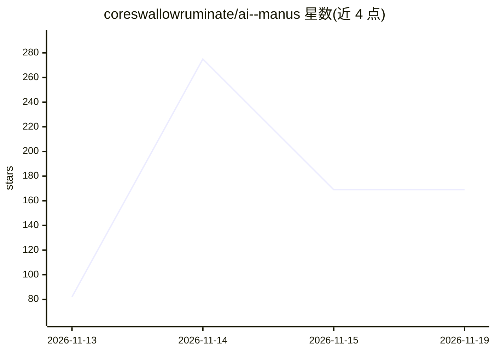

# coreswallowruminate/ai--manus

⭐ 169 · Apache-2.0 · 推送 2026-11-15 · [GitHub](https://github.com/coreswallowruminate/ai--manus) · 个人维护

**自主 AI Agent：代用户执行代码与控制浏览器完成多步任务**

面向个人用户（学生、远程工作者、轻度办公人群）的自主 AI 助手：用户以自然语言描述需求，agent 自行编写并执行脚本、打开网页、填写表单、跨页面收集信息，可执行多步骤任务并保持会话间的模式一致性。定位为家庭、学习与轻量办公场景的小型工具，明确声明不是企业级平台或重型套件。README 为营销式说明，未提供安装命令、代码仓库结构或技术实现细节，仅给出硬件兼容表（最低 4GB 内存、双核 CPU）与使用步骤说明，可验证的机制信息有限。

## 筛选速览

| 维度 | 判定 | 备注 |
|---|---|---|
| AI 角色 | `ai-native` | 本体是模型或模型工具 |
| 许可风险 | `permissive` | Apache-2.0 |
| 部署形态 | `None` |  |
| 模型依赖 | — | README 未给出锁定关系 |
| 硬件要求 | — | 无带数字的原话,不猜 |
| 安装摩擦 | `low` | 无编译、无系统依赖或容器化 |
| 成熟度 | — | 结构信号不足 |

## 能力要点

- 自主执行代码与浏览器操作（导航网页、填表、采集信息）
- 脚本与浏览器动作可在同一任务流中衔接
- 支持跨会话记住并复用工作流模式
- 面向家庭、学习与轻量办公的小规模任务

## 适用场景

- 让 agent 代我查网页、填重复表单、整理资料
- 把日常小任务（文件检查、多页信息汇总）委托给后台助手
- 快速跑小脚本和实验而不搭完整开发环境

## 场景标签

`AI 助手` `浏览器自动化` `编码 Agent` · 领域:效率与自动化

## 证据(README 行号)

> L10: - **Autonomous Code Execution:** Manus AI agent runs code on its own to complete tasks, so you can focus on decisio
> L18: Manus is an autonomous AI agent designed to run code and control a browser on your behalf. Instead of acting like a

## 星数曲线

2026-11-13 82 → 2026-11-19 169（+87）

---
*卡片 v1 · prompt 1.4 · 生成 2026-11-17 · 置信度 mid · 依据 README sha `a3d88e202bf0` · [字段定义](../../DATASET.md)*
