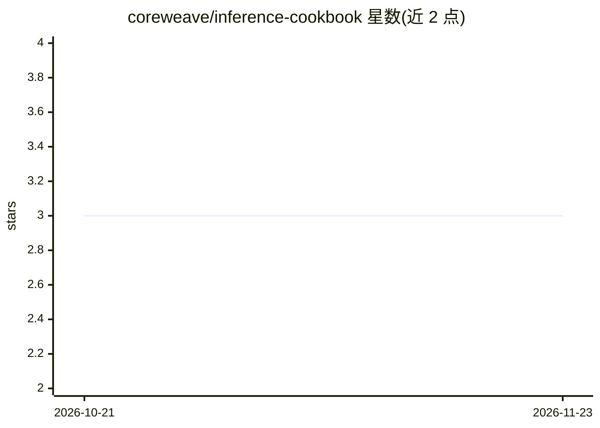

# coreweave/inference-cookbook

⭐ 3 · Python · Apache-2.0 · 推送 2026-11-20 · [GitHub](https://github.com/coreweave/inference-cookbook) · [官网](https://docs.coreweave.com/products/inference/dedicated) · 组织维护

**面向 CoreWeave 推理部署的 RL 训练配方与 cwtrain 库**

CoreWeave 维护的可运行强化学习（RL）配方集合与 cwtrain Python 库/CLI。核心机制是 RL Rollouts 的 checkpoint 热加载：训练器每步发布新权重，部署的每个副本原地切换权重，下一批 rollout 来自部署的 OpenAI 兼容端点，训练器自身不运行推理引擎。提供 miles、slime、NeMo-RL、Axolotl 四个配方及 GRPO/SFT 示例，在 Kubernetes 上端到端运行。前提是需 CoreWeave Dedicated Inference 账户并启用 RL Rollouts、GPU 配额、对象存储桶和 Python 3.12+。

## 筛选速览

| 维度 | 判定 | 备注 |
|---|---|---|
| AI 角色 | `ai-ecosystem` | LLM/agent 周边工具 |
| 许可风险 | `permissive` | Apache-2.0 |
| 部署形态 | `library` | 以包/库形式分发 |
| 模型依赖 | — | README 未给出锁定关系 |
| 硬件要求 | — | 无带数字的原话,不猜 |
| 安装摩擦 | `low` | 无编译、无系统依赖或容器化 |
| 成熟度 | — | 结构信号不足 |

## 能力要点

- cwtrain 库与 CLI 管理部署创建、权重发布与热加载
- 增量 delta 权重更新（zstd 压缩 XOR + Adler-32 校验），每 20 步全量快照
- 集成 miles、slime、NeMo-RL 训练框架，CLI 可接任意训练循环
- W&B 记录热加载耗时与 rollout 延迟指标

## 适用场景

- 在 CoreWeave 专用推理部署上跑 GRPO 训练
- 训练器不自带推理引擎，rollout 由独立 GPU 部署提供
- 将 HuggingFace safetensors 检查点热加载到在线推理部署

## 场景标签

`强化学习` · 领域:训练与推理

## 证据(README 行号)

> L5: deployment, and `cwtrain`, the Python library and CLI that the recipes share.
> L13: `cwtrain` does the CoreWeave side of a run. It creates the deployment that the run samples from,
> L22: - **No inference engines in the trainer.** Rollouts come from a deployment that runs and scales

## 星数曲线

2026-10-21 3 → 2026-11-23 3（+0）

---
*卡片 v1 · prompt 1.4 · 生成 2026-11-22 · 置信度 high · 依据 README sha `12f31a7041f6` · [字段定义](../../DATASET.md)*
