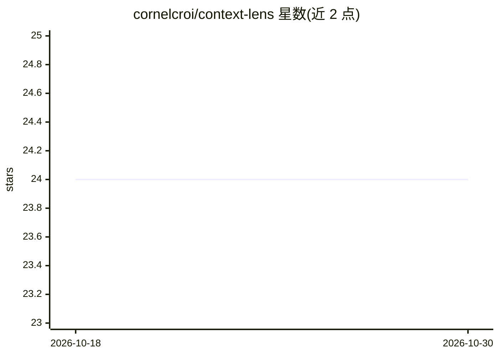

# cornelcroi/context-lens

⭐ 24 · Python · MIT · 推送 2025-11-20 · [GitHub](https://github.com/cornelcroi/context-lens) · 个人维护

**为 MCP 客户端提供本地语义搜索知识库的服务器**

自包含的 Model Context Protocol（MCP）服务器，把本地文件、GitHub 仓库或 URL 文档解析为基于语义的知识库：按文件类型用 AST 等专用解析器切块，用本地模型 all-MiniLM-L6-v2 生成 384 维向量，存入嵌入式 LanceDB，以余弦相似度检索，全程本地无 API key。面向 Claude Desktop、Cursor、Kiro 等 MCP 客户端用户及 Python 开发者，提供 7 个 MCP 工具（添加/搜索/列表/删除文档等），嵌入模型约 90-100MB 首次运行时下载。

## 筛选速览

| 维度 | 判定 | 备注 |
|---|---|---|
| AI 角色 | `ai-ecosystem` | LLM/agent 周边工具 |
| 许可风险 | `permissive` | MIT |
| 部署形态 | `library` | 以包/库形式分发 |
| 模型依赖 | — | README 未给出锁定关系 |
| 硬件要求 | — | 无带数字的原话,不猜 |
| 安装摩擦 | `low` | 无编译、无系统依赖或容器化 |
| 成熟度 | — | 结构信号不足 |

## 能力要点

- 语言感知解析（Python AST/JSON/Markdown 头部分级等），不切断函数
- 本地 all-MiniLM-L6-v2 生成 384 维向量，LanceDB 单文件存储，无外部 API 调用
- 支持本地目录、GitHub 仓库（可指定分支/目录）与直接 URL 三种内容来源，25+ 文件扩展名
- 发布到官方 MCP Registry，可用 io.github.cornelcroi/context-lens 引用

## 适用场景

- 让 Claude Desktop/Cursor 等 MCP 客户端语义检索我的代码库与文档
- 离线索引开源仓库后用自然语言提问理解项目结构
- 对合同、政策等文本文档做语义搜索而不依赖云服务

## 场景标签

`文档解析` `语义搜索` · 领域:知识与检索

## 证据(README 行号)

> L11: Context Lens transforms any content into a **searchable knowledge base** for your AI assistant. This self-contained
> L27: Context Lens uses **LanceDB** - a modern, serverless vector database:
> L38: - 🔍 **Semantic Search** - Understand meaning, not just keywords

## 星数曲线

2026-10-18 24 → 2026-10-30 24（+0）

---
*卡片 v1 · prompt 1.4 · 生成 2026-10-27 · 置信度 high · 依据 README sha `28ca305d9b16` · [字段定义](../../DATASET.md)*
