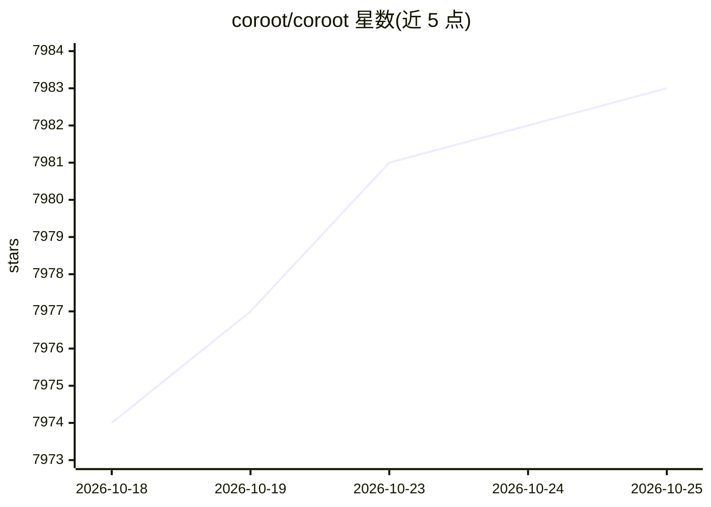

# coroot/coroot

⭐ 7,983 · Go · Apache-2.0 · 推送 2026-10-21 · [GitHub](https://github.com/coroot/coroot) · [官网](https://coroot.com) · 组织维护

**给运维/开发者的开源可观测性工具，AI 定位根因**

Coroot 是开源的可观测性与 APM 工具，面向运维与开发团队。基于 eBPF 实现零侵入采集指标、日志、链路追踪与持续性能剖析，提供服务地图、预定义检查、SLO 跟踪与告警，并支持部署跟踪与按应用维度的云成本监控（AWS/GCP/Azure）。其 AI 能力用于根因分析：自动识别问题并在告警中汇总相关检查结果。以 Docker 容器或 Kubernetes 部署方式运行，另有 Coroot Enterprise 版本。

## 筛选速览

| 维度 | 判定 | 备注 |
|---|---|---|
| AI 角色 | `ai-enhanced` | 去掉 AI 部分产品仍成立 |
| 许可风险 | `permissive` | Apache-2.0 |
| 部署形态 | `None` |  |
| 模型依赖 | — | README 未给出锁定关系 |
| 硬件要求 | — | 无带数字的原话,不猜 |
| 安装摩擦 | `low` | 无编译、无系统依赖或容器化 |
| 成熟度 | — | 结构信号不足 |

## 能力要点

- eBPF 零侵入采集指标、日志、追踪与剖析
- 预定义检查自动审计应用，SLO 违例汇总为单一告警
- 部署跟踪：自动发现并对比每次发布的性能变化
- 按应用粒度的云成本监控

## 适用场景

- 监控 Kubernetes 集群中微服务的健康与 SLO
- 排查异常请求的分布式链路与代码级性能剖析
- 跟踪每次部署带来的性能与成本变化

## 场景标签

 · 领域:运维/可观测性

## 证据(README 行号)

> L6: ## Open-source observability augmented with actionable insights
> L15: * Metrics, logs, traces, and profiles are gathered automatically by using eBPF

## 星数曲线

2026-10-18 7,974 → 2026-10-25 7,983（+9）

---
*卡片 v1 · prompt 1.4 · 生成 2026-10-20 · 置信度 high · 依据 README sha `c5139430635f` · [字段定义](../../DATASET.md)*
