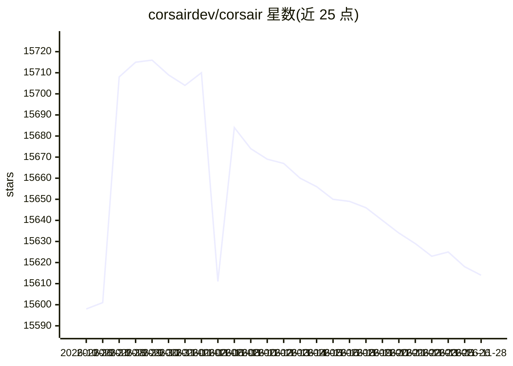

# corsairdev/corsair

⭐ 15,614 · TypeScript · NOASSERTION · 推送 2026-11-27 · [GitHub](https://github.com/corsairdev/corsair) · [官网](https://corsair.dev) · 组织维护

**面向开发者的产品集成平台，连接用户与应用**

Corsair 是一个产品集成平台，覆盖 agent 集成、后端服务与多租户 dashboard 场景。它基于 REST API 构建，使同一集成层可服务于 agents、后端服务与用户 dashboard；为每个集成提供统一语法，由官方维护适配器。可自托管，或使用 Hub 托管 OAuth 刷新与 webhooks。以 npm 包形式提供，含 MCP connector，Apache-2.0 许可。

## 筛选速览

| 维度 | 判定 | 备注 |
|---|---|---|
| AI 角色 | `ai-ecosystem` | LLM/agent 周边工具 |
| 许可风险 | `none` | NOASSERTION |
| 部署形态 | `None` |  |
| 模型依赖 | — | README 未给出锁定关系 |
| 硬件要求 | — | 无带数字的原话,不猜 |
| 安装摩擦 | `low` | 无编译、无系统依赖或容器化 |
| 成熟度 | — | 结构信号不足 |

## 动量与使用信号

- 维护:`active` — 距上次 push 3.5 天,年发版 1,274 位贡献者
- 涨星:近 1 天 **+204**(自 20261016 起算)
- 安装:github 包 `release-assets` 月下载无数据
- 平台:— · 协议:MCP

## 能力要点

- 基于 REST API 的集成层，同一层服务于 agent、后端与 dashboard
- 所有集成统一语法，官方维护适配器
- 支持自托管或 Hub 托管 OAuth 刷新与 webhooks
- 提供 npm 包与 MCP connector

## 适用场景

- 让 agent 跨多个第三方集成工作
- 为用户搭建连接各应用的 dashboard
- 减少为每个第三方 API 编写胶水代码

## 场景标签

`Agent 框架` · 领域:Agent 开发

## 证据(README 行号)

> L9: Corsair is a fully-featured product integration platform with a seamless DX. Build anything, from an agent working a
> L17: Most agent integration tools are MCP-only. Corsair is built on a REST API, so the same integration layer works for 

## 星数曲线

2026-10-26 15,598 → 2026-11-28 15,614（+16）

---
*卡片 v1 · prompt 1.4 · 生成 2026-11-28 · 置信度 mid · 依据 README sha `69b5a55def33` · [字段定义](../../DATASET.md)*
