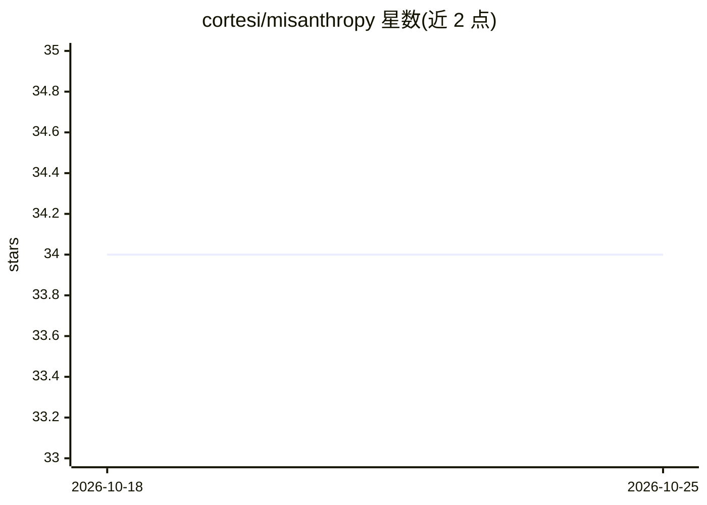

# cortesi/misanthropy

⭐ 34 · Rust · MIT · 推送 2026-09-27 · [GitHub](https://github.com/cortesi/misanthropy) · 个人维护

**Rust 开发者访问 Anthropic API 的绑定库与 CLI**

包含两个组件：misanthropy（Rust 客户端库）与 misan（命令行工具），用于访问 Anthropic API 与 Claude 模型。库支持扩展思考、工具调用（配合 schemars 生成 JSON Schema 的强类型工具输入）、文本与图像内容消息、流式响应，客户端可配置默认模型与 token 上限。CLI 通过 misan --help 查看用法，配置需设置 ANTHROPIC_API_KEY 环境变量。库内附 examples 目录演示各功能。

## 筛选速览

| 维度 | 判定 | 备注 |
|---|---|---|
| AI 角色 | `ai-ecosystem` | LLM/agent 周边工具 |
| 许可风险 | `permissive` | MIT |
| 部署形态 | `library` | 以包/库形式分发 |
| 模型依赖 | locked-api |  |
| 硬件要求 | — | 无带数字的原话,不猜 |
| 安装摩擦 | `low` | 无编译、无系统依赖或容器化 |
| 成熟度 | — | 结构信号不足 |

## 能力要点

- Anthropic API 的 Rust 客户端库与 misan CLI 两部分组成
- 支持扩展思考、工具调用、流式响应
- 消息支持文本与图像内容
- 基于 schemars 的强类型工具输入定义

## 适用场景

- 在 Rust 项目中接入 Anthropic/Claude API
- 通过命令行快速调用 Anthropic API
- 在 Rust 中实现带工具调用的 Claude 对话

## 场景标签

 · 领域:LLM API 客户端/开发库

## 证据(README 行号)

> L7: Misanthropy is set of Rust bindings for Anthropic API, providing easy access to
> L10: 1. `misanthropy`: A Rust client library for the Anthropic API
> L11: 2. `misan`: A command-line interface (CLI) tool for quick interactions with the API

## 星数曲线

2026-10-18 34 → 2026-10-25 34（+0）

---
*卡片 v1 · prompt 1.4 · 生成 2026-10-25 · 置信度 high · 依据 README sha `97fe0aff4c32` · [字段定义](../../DATASET.md)*
