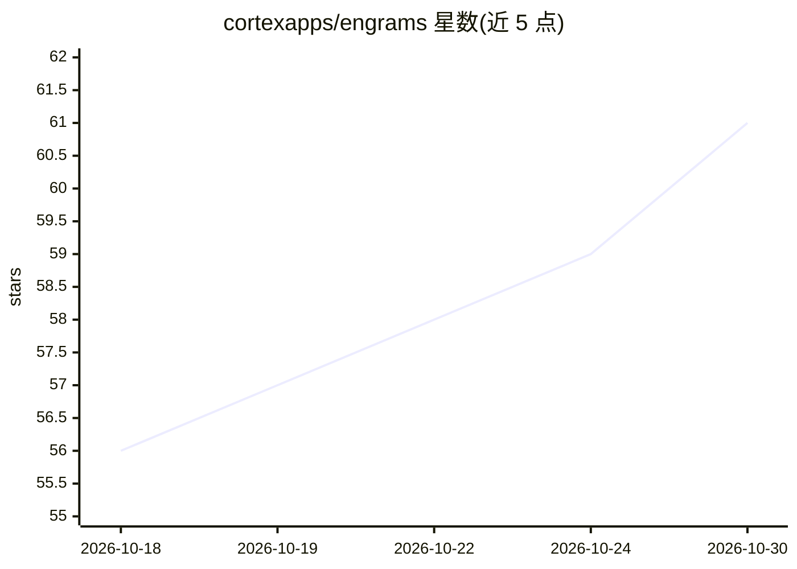

# cortexapps/engrams

⭐ 61 · Rust · AGPL-3.0 · 推送 2026-10-29 · [GitHub](https://github.com/cortexapps/engrams) · [官网](https://engramsfactory.com/) · 组织维护

**自托管 AI 编码 agent 编排器：Firecracker 微VM 中运行并快照**

在企业自有云上运行的 AI coding agent 编排平台：每个会话是一个 OCI 镜像加 agent harness，在 Firecracker microVM（KVM 隔离）中启动；agent 空闲时将 VM 内存与磁盘快照为内容寻址分块并销毁 VM，下个 prompt 到达时恢复（同主机 <100ms）。提供 dashboard、CLI、Slack/Webhook 集成与自动化流水线，Claude Code 与 Codex 作为 harness 附带；模型 key 需自备（Anthropic/OpenAI 或 OpenRouter）。自述为 0.x 项目，生产部署需 Kubernetes + Terraform/Helm。

## 筛选速览

| 维度 | 判定 | 备注 |
|---|---|---|
| AI 角色 | `ai-ecosystem` | LLM/agent 周边工具 |
| 许可风险 | `viral` | AGPL-3.0 |
| 部署形态 | `self-host` | docker 或自建部署 |
| 模型依赖 | locked-api |  |
| 硬件要求 | — | 无带数字的原话,不猜 |
| 安装摩擦 | `low` | 无编译、无系统依赖或容器化 |
| 成熟度 | `idea` | |

## 能力要点

- Firecracker microVM 硬件级隔离运行 AI 编码 agent
- 空闲会话快照为内容寻址分块，按需恢复（同主机 <100ms）
- 存储按哈希去重，基础镜像只存一份
- 24 个内置连接器与触发式自动化流水线

## 适用场景

- 企业内自托管运行 Claude Code/Codex 等编码 agent 并审计其操作
- 通过 Slack、PR、定时任务触发 agent 流水线
- 控制成本：空闲会话不占计算资源

## 场景标签

`编码 Agent` `Agent 框架` · 领域:Agent 开发

## 证据(README 行号)

> L5: engrams is a self-hosted orchestrator for AI coding agents. It runs each agent in its own Firecracker microVM, snaps
> L7: A session is a plain OCI image plus an agent harness. You build the image with `docker build`, enable it once, and e
> L25: - **engrams is not a model provider.** You bring an Anthropic or OpenAI key, or point it at a router such as OpenRo

## 星数曲线

2026-10-18 56 → 2026-10-30 61（+5）

---
*卡片 v1 · prompt 1.4 · 生成 2026-10-24 · 置信度 mid · 依据 README sha `8dea3244176e` · [字段定义](../../DATASET.md)*
