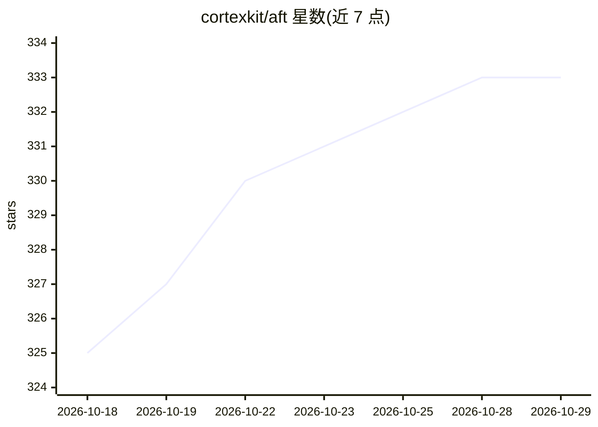

# cortexkit/aft

⭐ 333 · Rust · MIT · 推送 2026-10-28 · [GitHub](https://github.com/cortexkit/aft) · [官网](https://discord.gg/DSa65w8wuf) · 组织维护

**为编码 agent 提供符号级代码感知与执行环境的工具层**

以 Rust 二进制加各 harness 适配包形式提供的编码 agent 工具层：接管宿主（OpenCode/Pi/OMP）内置的 read/write/edit/bash/grep 工具槽，改由 tree-sitter 解析、索引搜索、输出压缩与符号感知操作支撑，并追加 aft_ 工具族。感知层提供文件大纲、符号缩放、语义+词法混合检索（支持本地/OpenAI 兼容/Ollama 嵌入后端）、调用图与代码健康检查；运动层提供符号级编辑、多文件事务补丁、AST 搜索替换；脑干层提供后台任务、PTY 会话、输出压缩与撤销栈。JSON-over-stdio 协议，每项目根一个常驻进程。

## 筛选速览

| 维度 | 判定 | 备注 |
|---|---|---|
| AI 角色 | `ai-ecosystem` | LLM/agent 周边工具 |
| 许可风险 | `permissive` | MIT |
| 部署形态 | `library` | 以包/库形式分发 |
| 模型依赖 | local-ok | 支持本地模型 |
| 硬件要求 | — | 无带数字的原话,不猜 |
| 安装摩擦 | `high` | 编译与系统依赖俱全 |
| 成熟度 | `idea` | |

## 能力要点

- 接管 OpenCode/Pi/OMP 宿主工具槽，替换为 tree-sitter 与索引支撑的实现
- aft_search 语义+词法混合检索，可选本地/OpenAI 兼容/Ollama 嵌入后端
- 后台 bash 任务、PTY 会话与多级输出压缩
- 25+ 种语言的 outline/edit/AST/语义检索能力矩阵

## 适用场景

- 让编码 agent 按符号而非整文件读写代码，减少 token 消耗
- 为 agent 提供调用图、影响分析与代码健康检查
- 在 agent 环境中运行后台任务与交互式终端会话

## 场景标签

`Agent 框架` `语义搜索` · 领域:Agent 开发

## 证据(README 行号)

> L41: AFT ships as a Rust binary with thin adapters for OpenCode, Pi, and OMP (oh-my-pi). It **hoists the host's built-in
> L47: |**OpenCode**|Native adapter|`@cortexkit/aft-opencode`|`disabled_tools`, `indexes`, `edit_mode`|

## 星数曲线

2026-10-18 325 → 2026-10-29 333（+8）

---
*卡片 v1 · prompt 1.4 · 生成 2026-10-21 · 置信度 high · 依据 README sha `978a6ff345c3` · [字段定义](../../DATASET.md)*
