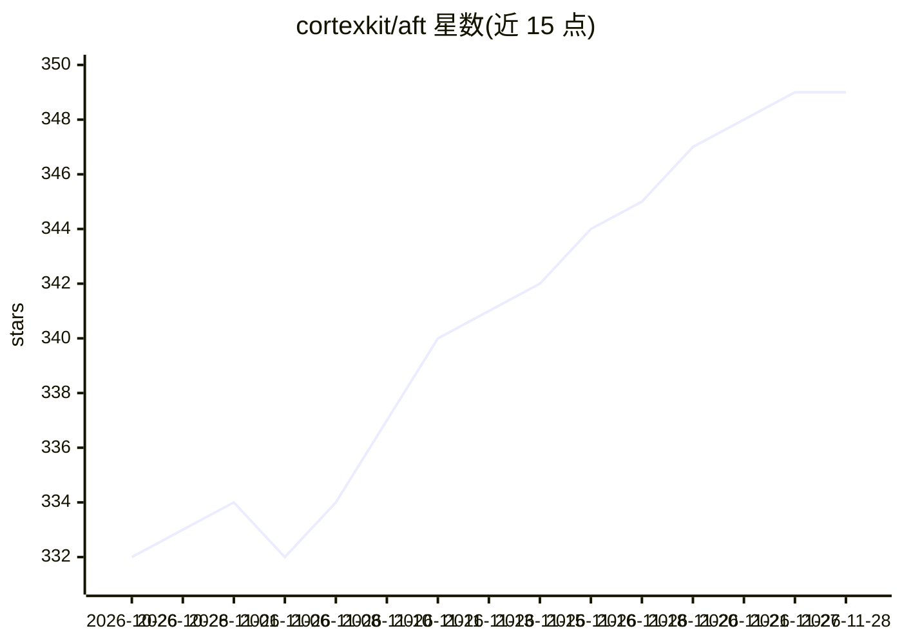

# cortexkit/aft

⭐ 349 · Rust · MIT · 推送 2026-11-27 · [GitHub](https://github.com/cortexkit/aft) · [官网](https://discord.gg/DSa65w8wuf) · 组织维护

**给 coding agent 提供 IDE 级工具与 OS 级运行环境的插件**

AFT 是一个 Rust 二进制，通过适配器接入 OpenCode、Pi、OMP 等 coding agent harness，替换宿主内置的 read/write/edit/grep/bash 工具槽位，使其由 tree-sitter 解析、索引搜索与输出压缩支撑，并追加 aft_ 工具族。功能分三层：Sensory 提供符号级大纲、语义检索、调用图；Motor 提供符号级编辑、重构、AST 结构替换；Brainstem 提供后台任务、PTY 会话、输出压缩与 undo 栈。MIT 许可，支持约 28 种语言的 outline/edit，语义检索覆盖部分语言。

## 筛选速览

| 维度 | 判定 | 备注 |
|---|---|---|
| AI 角色 | `ai-ecosystem` | LLM/agent 周边工具 |
| 许可风险 | `permissive` | MIT |
| 部署形态 | `library` | 以包/库形式分发 |
| 模型依赖 | local-ok | 支持本地模型 |
| 硬件要求 | — | 无带数字的原话,不猜 |
| 安装摩擦 | `high` | 编译与系统依赖俱全 |
| 成熟度 | — | 结构信号不足 |

## 能力要点

- 符号级大纲、语义+词法混合检索与调用图分析（aft_outline/zoom/search/callgraph）
- 替换宿主内置 read/edit/bash 工具并叠加 aft_ 工具族，输出按层级压缩以降低 token 用量
- 后台任务、PTY 会话与跨重启持久化的 undo 栈与命名检查点
- 通过 OpenCode/Pi 原生插件与 OMP（经 Pi 插件）接入

## 适用场景

- 为 OpenCode 或 Pi 中的 coding agent 提供代码结构感知与符号级编辑工具
- 减少 agent 读整文件与编辑错位造成的 token 消耗
- 让 agent 在同一项目下运行后台构建、测试等长任务并压缩输出

## 场景标签

`编码 Agent` · 领域:编码与开发

## 证据(README 行号)

> L41: AFT ships as a Rust binary with thin adapters for OpenCode, Pi, and OMP (oh-my-pi). It **hoists the host's built-in
> L43: ### Supported harnesses
> L97: - **`aft_search`**: find code by *meaning* when grep keywords fall short. Hybrid semantic + lexical retrieval over 

## 星数曲线

2026-10-26 332 → 2026-11-28 349（+17）

---
*卡片 v1 · prompt 1.4 · 生成 2026-11-25 · 置信度 high · 依据 README sha `f53e4763d213` · [字段定义](../../DATASET.md)*
