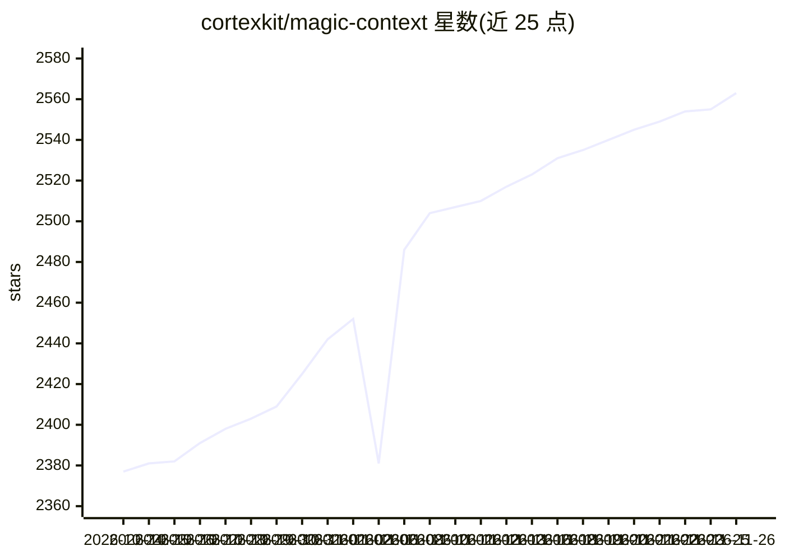

# cortexkit/magic-context

⭐ 2,563 · TypeScript · MIT · 推送 2026-11-25 · [GitHub](https://github.com/cortexkit/magic-context) · [官网](https://discord.gg/DSa65w8wuf) · 组织维护 · 中文 README

**为编码 agent 提供自管理上下文与跨会话长期记忆的插件**

CortexKit 系列中的插件，以编码 agent 的"海马体"为定位：后台 historian 将旧历史压缩为分层摘要（免压缩停顿），夜间 dreamer agent 对照代码库校验并整理记忆，每轮自动召回并在需要时跨记忆、历史会话与 git 历史检索。支持 OpenCode、Pi、OMP 三类宿主，配置按宿主分离，与宿主内置压缩及其他上下文管理插件冲突时自动停用（fail-safe）。通过 npm 分发，需要为 historian 配置真实模型。

## 筛选速览

| 维度 | 判定 | 备注 |
|---|---|---|
| AI 角色 | `ai-ecosystem` | LLM/agent 周边工具 |
| 许可风险 | `permissive` | MIT |
| 部署形态 | `library` | 以包/库形式分发 |
| 模型依赖 | local-ok | 支持本地模型 |
| 硬件要求 | — | 无带数字的原话,不猜 |
| 安装摩擦 | `low` | 无编译、无系统依赖或容器化 |
| 成熟度 | — | 结构信号不足 |

## 能力要点

- 后台 historian 压缩旧历史为分层摘要，消除 compaction 停顿
- 夜间 dreamer agent 校验、去重、晋升项目记忆
- 缓存稳定布局与确定性衰减渲染，可搭配本地模型运行 historian
- doctor 命令自动检测宿主冲突并修复

## 适用场景

- 让编码 agent 在项目中保持长期记忆、跨会话延续
- 长时间会话中避免 compaction 中断工作流
- 在多个宿主（OpenCode/Pi/OMP）间共享项目记忆

## 场景标签

`Agent 记忆` · 领域:Agent 开发

## 证据(README 行号)

> L35: Magic Context gives them one. It is the **hippocampus** for coding agents, the part of the brain that forms memorie
> L51: Auto-detects which harnesses you have installed (OpenCode, Pi, OMP, or any combination) and configures each one: it

## 星数曲线

2026-10-24 2,377 → 2026-11-26 2,563（+186）

---
*卡片 v1 · prompt 1.4 · 生成 2026-11-23 · 置信度 high · 依据 README sha `f58383e83b11` · [字段定义](../../DATASET.md)*
