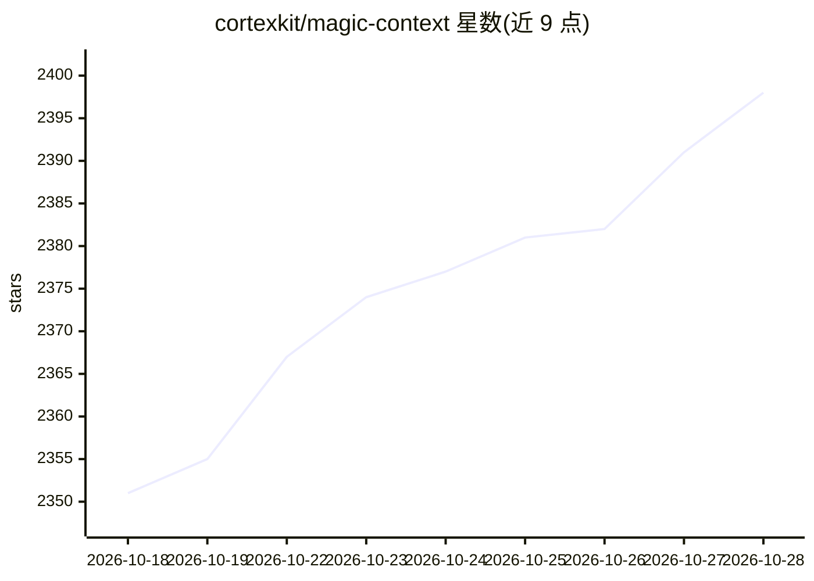

# cortexkit/magic-context

⭐ 2,398 · TypeScript · MIT · 推送 2026-10-27 · [GitHub](https://github.com/cortexkit/magic-context) · [官网](https://discord.gg/DSa65w8wuf) · 组织维护

**编码代理的自管理上下文与长期记忆插件**

CortexKit 系列插件之一，为 OpenCode、Pi、OMP 等编码代理提供后台上下文管理与长期记忆：后台 historian 将旧历史压缩为分层摘要，dreamer 代理定期核对与整理记忆，按轮次自动召回并支持跨记忆、历史会话与 git 历史检索；记忆与嵌入在多个 harness 间共享同一数据库。安装会关闭宿主自带压缩机制，与其他上下文管理插件冲突时自动停用（fail-safe）。以 npm 包提供，通过 npx setup 向导配置；不回填安装前的历史会话。

## 筛选速览

| 维度 | 判定 | 备注 |
|---|---|---|
| AI 角色 | `ai-ecosystem` | LLM/agent 周边工具 |
| 许可风险 | `permissive` | MIT |
| 部署形态 | `library` | 以包/库形式分发 |
| 模型依赖 | local-ok | 支持本地模型 |
| 硬件要求 | — | 无带数字的原话,不猜 |
| 安装摩擦 | `low` | 无编译、无系统依赖或容器化 |
| 成熟度 | — | 结构信号不足 |

## 能力要点

- historian 分层摘要压缩旧历史，无需 compaction 暂停
- dreamer 代理夜间核对、去重与整理项目记忆
- 记忆/嵌入跨 OpenCode、Pi、OMP 共享同一数据库
- 衰减渲染与缓存感知的延迟删减，确定性无 LLM 规则

## 适用场景

- 让编码代理长期维持单一会话并保留项目记忆
- 跨会话召回过去的决策、约定与配置
- 避免上下文压缩暂停打断编码流程

## 场景标签

`Agent 记忆` · 领域:Agent 开发

## 证据(README 行号)

> L35: Magic Context gives them one. It is the **hippocampus** for coding agents, the part of the brain that forms memorie
> L51: Auto-detects which harnesses you have installed (OpenCode, Pi, OMP, or any combination) and configures each one: it

## 星数曲线

2026-10-18 2,351 → 2026-10-28 2,398（+47）

---
*卡片 v1 · prompt 1.4 · 生成 2026-10-21 · 置信度 high · 依据 README sha `27c7346ec848` · [字段定义](../../DATASET.md)*
