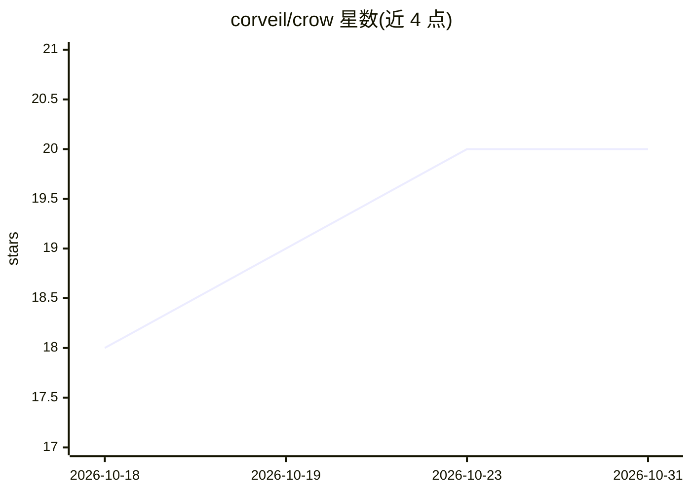

# corveil/crow

⭐ 20 · Swift · Apache-2.0 · 推送 2026-10-29 · [GitHub](https://github.com/corveil/crow) · 个人维护

**自托管 Web 会话管理器：并行编排多个 AI 编码 agent 与 git worktree**

自托管守护进程 crowd 加 Web UI：将 Claude Code、Codex、Cursor、OpenCode 等编码 agent 分别置于独立 git worktree 中并行运行，由 GitHub/GitLab/Jira 看板驱动。选取工单后自动创建 worktree、以工单为上下文启动 agent、更新看板状态并跟踪 PR 直至合并，还支持审查 PR、回应 review 意见、自动 rebase 过期分支。面向已使用编码 agent、想同时处理多个工单的开发者；需 Unix 类主机（macOS 14+/Linux）与 Swift 6 工具链从源码构建，尚无稳定版，Windows 不支持。

## 筛选速览

| 维度 | 判定 | 备注 |
|---|---|---|
| AI 角色 | `ai-ecosystem` | LLM/agent 周边工具 |
| 许可风险 | `permissive` | Apache-2.0 |
| 部署形态 | `None` |  |
| 模型依赖 | — | README 未给出锁定关系 |
| 硬件要求 | — | 无带数字的原话,不猜 |
| 安装摩擦 | `medium` | 含编译或系统依赖之一 |
| 成熟度 | `idea` | |

## 能力要点

- 每个 agent 会话运行在独立 git worktree，绑定 issue 与 PR 并跟踪至合并
- 支持 Claude Code、Codex、Cursor、OpenCode、Grok Build 等多 agent 按会话选择
- 任务后端与代码后端可分离（如 Jira 工单 + GitHub PR）
- 内置只读 MCP server 与 crow CLI 脚本化接口

## 适用场景

- 同时推进多个工单，让每个 AI agent 在独立分支上工作互不干扰
- 自动把 issue 状态在看板上流转并跟踪 PR 的检查、评审与合并
- 让 agent 回应 PR 评审意见并自动 rebase 过期分支

## 场景标签

`编码 Agent` `工作流自动化` · 领域:效率与自动化

## 证据(README 行号)

> L3: Crow is a self-hosted daemon and web UI for running AI coding agents — Claude Code, Codex, Cursor, OpenCode and othe
> L5: **Why.** One coding agent in one terminal is easy. Five at once is not: each needs its own branch and checkout so th

## 星数曲线

2026-10-18 18 → 2026-10-31 20（+2）

---
*卡片 v1 · prompt 1.4 · 生成 2026-10-28 · 置信度 high · 依据 README sha `499a620e6eed` · [字段定义](../../DATASET.md)*
