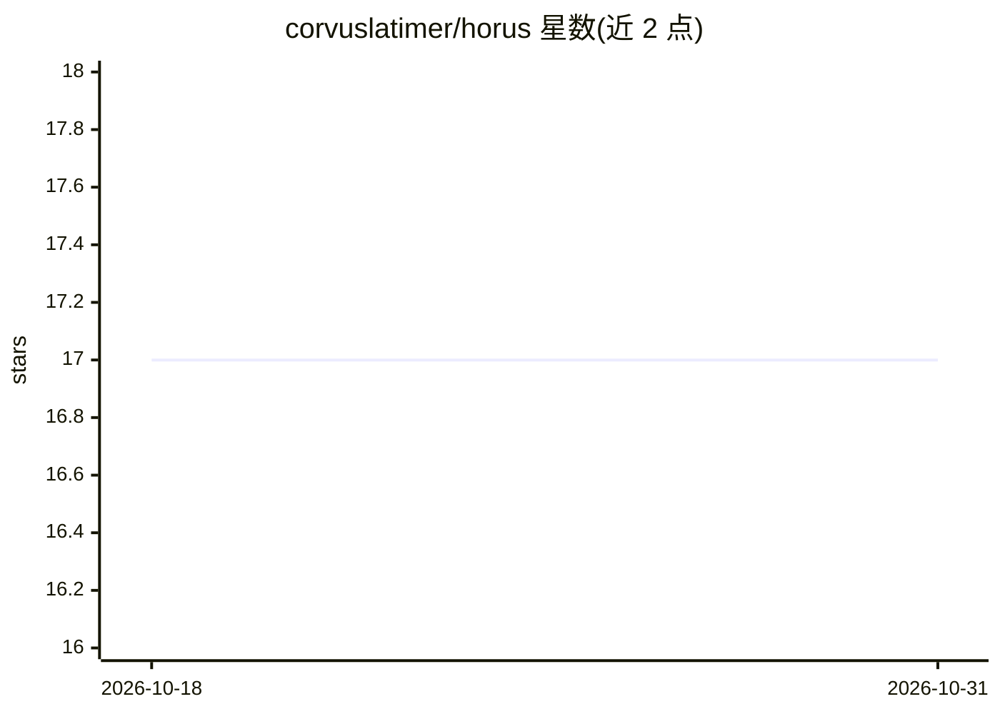

# corvuslatimer/horus

⭐ 17 · JavaScript · Apache-2.0 · 推送 2026-03-02 · [GitHub](https://github.com/corvuslatimer/horus) · [官网](https://horusintel.xyz) · 个人维护

**本地运行的实时 OSINT 情报仪表盘，接入 OpenClaw agent**

开源独立 OSINT 终端，面向快速态势感知：聚合实时信号、事件、军用航班上下文、市场叠加层，并提供集成 agent 聊天。架构为 React+Vite 前端读取 relay 服务 (/api/*)，relay 轮询上游数据源并本地持久化 (signals.ndjson)。设计为与 OpenClaw agent 直连，可通过文本对话获取态势查询。处于活跃开发中，README 明确标注状态为快速演进。

## 筛选速览

| 维度 | 判定 | 备注 |
|---|---|---|
| AI 角色 | `ai-enhanced` | 去掉 AI 部分产品仍成立 |
| 许可风险 | `permissive` | Apache-2.0 |
| 部署形态 | `library` | 以包/库形式分发 |
| 模型依赖 | — | README 未给出锁定关系 |
| 硬件要求 | — | 无带数字的原话,不猜 |
| 安装摩擦 | `low` | 无编译、无系统依赖或容器化 |
| 成熟度 | `idea` | |

## 能力要点

- 本地优先运行时，relay 轮询上游源并持久化状态
- 与 OpenClaw agent 集成，支持跨渠道 agent 工作流
- 模块化地图层（热点/航线/咽喉点/基地/电缆/管线/冲突）

## 适用场景

- 实时监控全球事件信号与市场动态
- 通过 OpenClaw agent 远程文本查询态势
- 运营者在单一界面中聚合多源 OSINT 情报

## 场景标签

 · 领域:OSINT/情报监控

## 证据(README 行号)

> L7: It combines live signals, incident aggregation, military flight context, market overlays, and an integrated agent ch
> L9: It is designed to integrate directly with your OpenClaw agent, so you can text it from anywhere on the go with promp

## 星数曲线

2026-10-18 17 → 2026-10-31 17（+0）

---
*卡片 v1 · prompt 1.4 · 生成 2026-10-29 · 置信度 mid · 依据 README sha `eee96c66ab72` · [字段定义](../../DATASET.md)*
