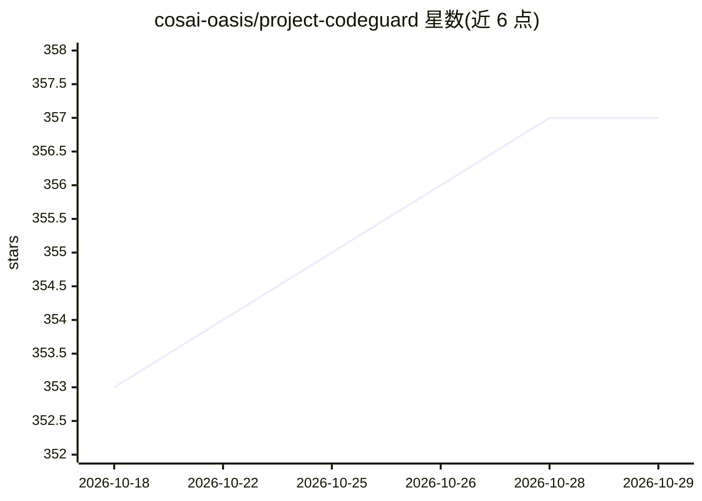

# cosai-oasis/project-codeguard

⭐ 357 · Python · NOASSERTION · 推送 2026-10-27 · [GitHub](https://github.com/cosai-oasis/project-codeguard) · [官网](https://project-codeguard.org/) · 组织维护

**面向 AI 编程 agent 的模型无关安全规则与技能框架**

由 CoSAI（OASIS 开放项目）维护的安全编码 agent 技能框架与规则集：以统一 markdown 格式提供密码学、输入校验、认证授权、供应链、云安全等领域的安全规则，经转换工具翻译为常见编程 agent 可用的格式，在代码生成前中后各阶段引导 AI 助手遵循安全实践；另附校验器测试技能与规则合规性，并提供 MCP 服务器将全部规则以工具形式经 HTTP 暴露，供组织集中部署。使用方式为从 releases 页下载技能与规则并复制到项目仓库。

## 筛选速览

| 维度 | 判定 | 备注 |
|---|---|---|
| AI 角色 | `ai-ecosystem` | LLM/agent 周边工具 |
| 许可风险 | `none` | NOASSERTION |
| 部署形态 | `desktop` | 安装包/桌面程序 |
| 模型依赖 | — | README 未给出锁定关系 |
| 硬件要求 | — | 无带数字的原话,不猜 |
| 安装摩擦 | `low` | 无编译、无系统依赖或容器化 |
| 成熟度 | — | 结构信号不足 |

## 能力要点

- 统一 markdown 格式的安全技能与规则，含后量子密码学等主题
- 转换工具将规则翻译为常见编程 agent 格式
- MCP 服务器经 streamable HTTP 暴露全部规则，支持集中部署
- 覆盖代码生成前（规划/规格驱动）、中、后（代码审查）全周期

## 适用场景

- 让我的 AI 编程助手在写代码时自动遵循安全最佳实践
- 在规划阶段就把安全模式纳入规格驱动开发
- 组织内集中部署 CodeGuard MCP 服务器供所有开发者接入

## 场景标签

`网络安全` · 领域:学习与行业

## 证据(README 行号)

> L11: Project CodeGuard is an AI model-agnostic security coding agent skills framework and ruleset that embeds secure-by-
> L58: This repository also includes an MCP server that exposes all CodeGuard security rules as tools over streamable HTTP

## 星数曲线

2026-10-18 353 → 2026-10-29 357（+4）

---
*卡片 v1 · prompt 1.4 · 生成 2026-10-21 · 置信度 high · 依据 README sha `8c6b9d2c21c6` · [字段定义](../../DATASET.md)*
