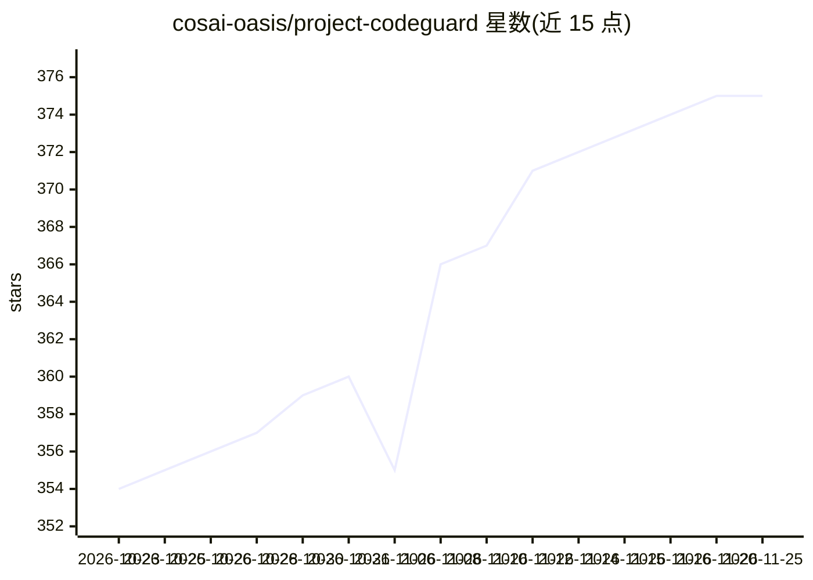

# cosai-oasis/project-codeguard

⭐ 375 · Python · NOASSERTION · 推送 2026-11-20 · [GitHub](https://github.com/cosai-oasis/project-codeguard) · [官网](https://project-codeguard.org/) · 组织维护

**给 AI 编码代理嵌入默认安全实践的规则与技能集**

由 Coalition for Secure AI（CoSAI，OASIS 开源项目）维护的安全框架，以 Agent Skill 形式分发：一个包含指令与安全指引的文件夹，编码代理在规划、编写与审查代码时参考。覆盖密码学、输入校验、认证授权、供应链、云安全、数据保护等域，针对 AI 生成代码常见问题（如硬编码密钥、缺失鉴权）提供指引。安装方式为将 skills/codeguard/ 文件夹复制到客户端技能目录，另含 security-review 与 memory-safe-migration 工作流。

## 筛选速览

| 维度 | 判定 | 备注 |
|---|---|---|
| AI 角色 | `ai-ecosystem` | LLM/agent 周边工具 |
| 许可风险 | `none` | NOASSERTION |
| 部署形态 | `None` |  |
| 模型依赖 | — | README 未给出锁定关系 |
| 硬件要求 | — | 无带数字的原话,不猜 |
| 安装摩擦 | `low` | 无编译、无系统依赖或容器化 |
| 成熟度 | — | 结构信号不足 |

## 能力要点

- 模型无关，以 Agent Skill 文件夹形式安装到客户端技能目录
- 覆盖 8 个安全域（含后量子密码、IaC 加固、SBOM 生成）
- 附带 security-review 与 memory-safe-migration 专用工作流
- 声明可配合现有测试、安全扫描器与人工审查使用

## 适用场景

- 让编码代理在写代码时自动遵循安全默认实践
- 用代理审查现有认证代码的安全问题
- 执行记忆安全迁移等专项安全任务

## 场景标签

`网络安全` `代码审查` · 领域:编码与开发

## 证据(README 行号)

> L13: Project CodeGuard is an open-source, model-agnostic security framework that embeds secure-by-default practices into
> L42: CodeGuard is an Agent Skill: a folder of instructions and security guidance for your coding agent. For personal use
> L59: CodeGuard gives your agent security guidance to consult while planning, writing, or reviewing code. The skill's ins

## 星数曲线

2026-10-23 354 → 2026-11-25 375（+21）

---
*卡片 v1 · prompt 1.4 · 生成 2026-11-25 · 置信度 high · 依据 README sha `b4c81a2a9f31` · [字段定义](../../DATASET.md)*
