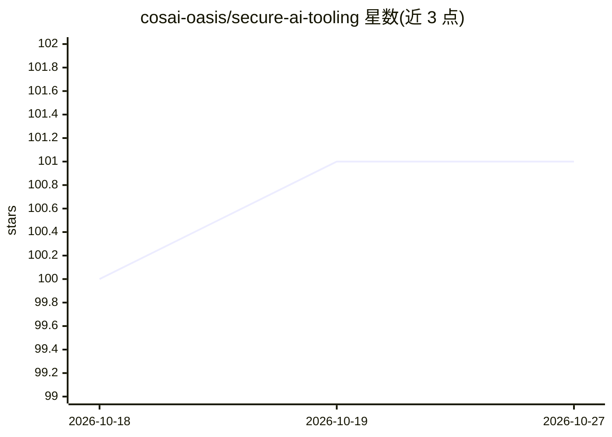

# cosai-oasis/secure-ai-tooling

⭐ 101 · Python · Apache-2.0 · 推送 2026-10-25 · [GitHub](https://github.com/cosai-oasis/secure-ai-tooling) · 组织维护

**AI 系统安全风险地图：风险、控制措施与角色的结构化框架**

CoSAI（OASIS 开放项目）维护的 AI 安全框架仓库，核心为 CoSAI Risk Map：将 AI 开发生命周期划分为 Data、Infrastructure、Model、Application 四组，以 Components、Risks、Controls、Personas 四类结构编目安全风险（如数据投毒、模型逃逸）与缓解控制，覆盖八类生命周期角色。内容以人类可读 .yaml 与 .schema.json 文件提供，并包含用于 GitHub Pages 的静态 Risk Map Explorer。框架映射 MITRE ATLAS、NIST AI RMF、STRIDE、OWASP Top 10 for LLM。代码与内容采用 Apache-2.0 许可，附下游复用契约文档。

## 筛选速览

| 维度 | 判定 | 备注 |
|---|---|---|
| AI 角色 | `ai-knowledge` | 知识聚合/清单类 |
| 许可风险 | `permissive` | Apache-2.0 |
| 部署形态 | `None` |  |
| 模型依赖 | — | README 未给出锁定关系 |
| 硬件要求 | — | 无带数字的原话,不猜 |
| 安装摩擦 | `low` | 无编译、无系统依赖或容器化 |
| 成熟度 | — | 结构信号不足 |

## 能力要点

- 四组生命周期（Data/Infrastructure/Model/Application）×四类结构（Components/Risks/Controls/Personas）的风险编目
- 以 .yaml 与 .schema.json 文件提供，支持机器读取与组织自评估
- 映射 MITRE ATLAS / NIST AI RMF / STRIDE / OWASP Top 10 for LLM 并自动校验一致性
- 附静态 Risk Map Explorer 供角色定位与浏览关联风险控制

## 适用场景

- 安全团队按角色梳理 AI 系统全生命周期的安全风险
- 将组织风险清单与 NIST AI RMF 等既有标准对齐
- 基于 yaml 数据构建内部 AI 安全评估工具

## 场景标签

`网络安全` · 领域:学习与行业

## 证据(README 行号)

> L13: The **CoSAI Risk Map** is a framework for identifying, analyzing, and mitigating security risks in Artificial Intel
> L26: * **Risks**: A catalog of potential security threats, such as Data Poisoning or Model Evasion.
> L30: The framework is provided as a set of human-readable .yaml files and machine-readable .schema.json files that you c

## 星数曲线

2026-10-18 100 → 2026-10-27 101（+1）

---
*卡片 v1 · prompt 1.4 · 生成 2026-10-23 · 置信度 high · 依据 README sha `a7058cb77849` · [字段定义](../../DATASET.md)*
