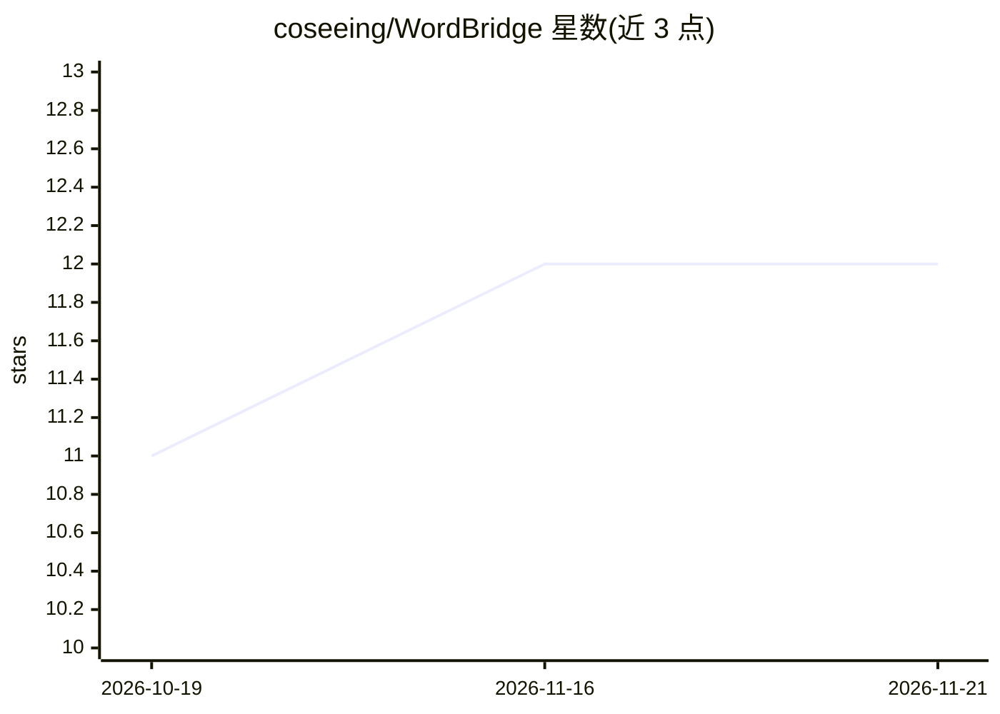

# coseeing/WordBridge

⭐ 12 · Python · GPL-2.0 · 推送 2026-11-08 · [GitHub](https://github.com/coseeing/WordBridge) · 组织维护 · 中文 README

**NVDA 插件：识别并纠正中文同音字错别字**

面向中文写作者的 NVDA 读屏插件：通过快捷键对选中文本做错别字检查，文本发送到所选云服务提供商的 LLM 处理，生成包含原文、建议修改及相关字词讲解的报告，帮助用户在校对中学习词汇用法。支持标准/轻量两种纠错模式、简繁中文转换与自定义个人词典（词典作为参考材料随检查发送给 LLM）。检查完成后纠正文本自动复制到剪贴板；自带 Coseeing 免费额度有限，大量使用需自备服务提供商 API key。

## 筛选速览

| 维度 | 判定 | 备注 |
|---|---|---|
| AI 角色 | `ai-native` | 本体是模型或模型工具 |
| 许可风险 | `viral` | GPL-2.0 |
| 部署形态 | `None` |  |
| 模型依赖 | — | README 未给出锁定关系 |
| 硬件要求 | — | 无带数字的原话,不猜 |
| 安装摩擦 | `low` | 无编译、无系统依赖或容器化 |
| 成熟度 | — | 结构信号不足 |

## 能力要点

- NVDA+Alt+O 一键检查选中文本，结果自动复制到剪贴板
- 纠错报告含原文、建议修改与相关字词讲解
- 标准/轻量两种纠错模式与简繁中文自动转换
- 个人词典可提供领域术语以提高纠错准确性

## 适用场景

- 校对中文文档中的同音字错别字
- 视障用户借助读屏环境检查中文写作
- 校对简体与繁体中文文本
- 在专业写作中加入个人词典提升纠错效果

## 场景标签

`AI 写作` · 领域:内容生成

## 证据(README 行号)

> L3: WordBridge is an AI-powered NVDA add-on that helps users identify and correct homophone-based typos in Chinese.
> L26: - **Large Language Model (LLM)**\
> L37:  Provide a custom vocabulary list to improve correction accuracy for domain-specific or specialized terminology. Yo

## 星数曲线

2026-10-19 11 → 2026-11-21 12（+1）

---
*卡片 v1 · prompt 1.4 · 生成 2026-11-18 · 置信度 high · 依据 README sha `7f789620fcf3` · [字段定义](../../DATASET.md)*
