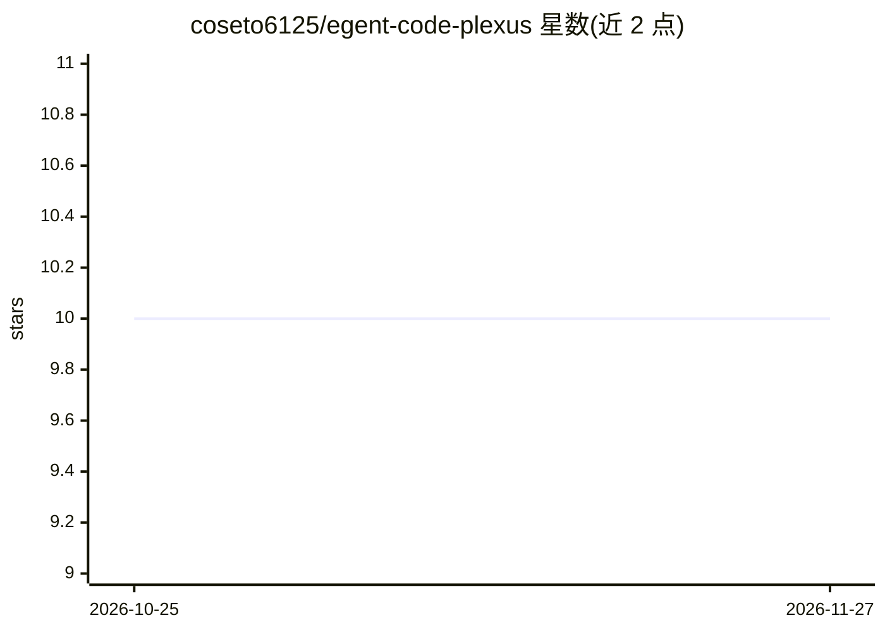

# coseto6125/egent-code-plexus

⭐ 10 · Rust · MIT · 推送 2026-11-26 · [GitHub](https://github.com/coseto6125/egent-code-plexus) · 个人维护

**为 AI 编码 agent 提供代码结构图查询的 CLI 工具**

以 Rust 实现的无状态 CLI，为代码仓库构建结构图索引（基于 tree-sitter 静态分析），供自主编码 agent 查询：符号解析、调用方/影响面分析、HTTP 路由枚举、跨仓库 API 契约、openCypher 查询，输出 TOON/紧凑 JSON 以节省上下文 token。无法静态解析的边以 BlindSpot 记录标注而非推测。支持 31 种语言，索引文件经 mmap 零拷贝读取，无需守护进程。面向自主编码 agent 的使用场景设计，另提供 MCP server 与 Claude Code/Codex/Gemini 集成。

## 筛选速览

| 维度 | 判定 | 备注 |
|---|---|---|
| AI 角色 | `ai-ecosystem` | LLM/agent 周边工具 |
| 许可风险 | `permissive` | MIT |
| 部署形态 | `desktop` | 安装包/桌面程序 |
| 模型依赖 | — | README 未给出锁定关系 |
| 硬件要求 | — | 无带数字的原话,不猜 |
| 安装摩擦 | `low` | 无编译、无系统依赖或容器化 |
| 成熟度 | `idea` | |

## 能力要点

- 无状态单次 CLI：查询含进程启动约 140–170 ms，无需守护进程
- 31 种语言的结构图覆盖（服务代码、IaC、SQL、智能合约等）
- BlindSpot 记录：显式标注无法解析的边，替代推测
- 提供 MCP server 与 agent 集成（Claude Code / Codex / Gemini hooks）

## 适用场景

- 让自主编码 agent 查询调用方与重构影响面
- 跨仓库检索 HTTP 路由与 API 契约
- 为 LLM prompt 生成紧凑的代码上下文数据

## 场景标签

`编码 Agent` · 领域:编码与开发

## 证据(README 行号)

> L3: ### The structural code graph built for AI agents, not humans.
> L24: Autonomous coding agents fire **20–50 structural queries per task**. Those queries all hit tools built for humans: 
> L137: |Primary consumer|Autonomous AI code agents|Human devs + IDE integration|

## 星数曲线

2026-10-25 10 → 2026-11-27 10（+0）

---
*卡片 v1 · prompt 1.4 · 生成 2026-11-19 · 置信度 mid · 依据 README sha `ab70c5068cab` · [字段定义](../../DATASET.md)*
