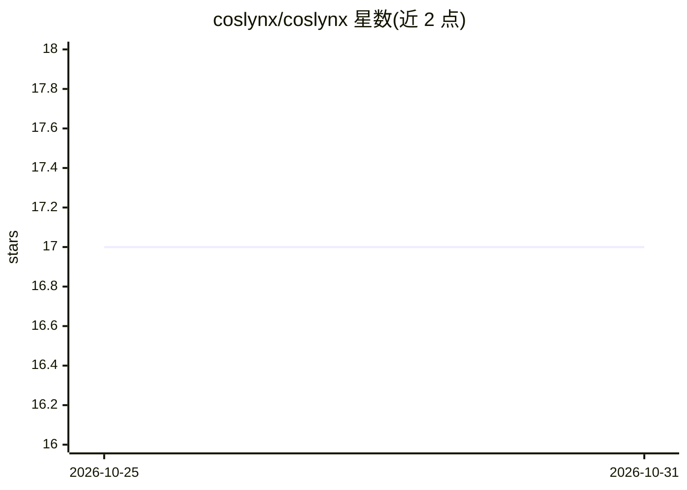

# coslynx/coslynx

⭐ 17 · 推送 2026-10-24 · [GitHub](https://github.com/coslynx/coslynx) · [官网](https://coslynx.com) · 组织维护

**开源组织页：本地 AI 短视频工厂及配套视频工具集**

Coslynx 的组织主页：核心产品 Content Factory 在用户本机与其自有 Claude 订阅上完成品牌短视频全流程——从 Reddit/HN/维基等来源选題并由陌生人小组投票、逐条事实核验、两种影片引擎与 90+ 视觉风格逐帧绘制（不用图像/视频生成模型）、低于 8 分的成片被扣留待人工处理。同时开源三个 MIT 许可、npx 即用的工具：video-safety-check 检测光敏闪烁（WCAG 2.3.1）与响度跳变（EBU R128）、open-media-finder 跨库检索可复用素材并生成署名行、ffmpeg-word-captions 从 Whisper 转录生成逐词字幕并烧录。

## 筛选速览

| 维度 | 判定 | 备注 |
|---|---|---|
| AI 角色 | `ai-native` | 本体是模型或模型工具 |
| 许可风险 | `none` | — |
| 部署形态 | `library` | 以包/库形式分发 |
| 模型依赖 | — | README 未给出锁定关系 |
| 硬件要求 | — | 无带数字的原话,不猜 |
| 安装摩擦 | `medium` | 含编译或系统依赖之一 |
| 成熟度 | — | 结构信号不足 |

## 能力要点

- Content Factory 在本机运行，选题、事实核验、配音、逐帧动画全流程自动化
- 低于 8/10 分的成片被扣留并给出原因，不自动发布
- 三个 MIT 开源工具均以 npx 一条命令运行，声明无依赖
- open-media-finder 按各素材自身许可过滤可复用内容并自动写署名行

## 适用场景

- 为我的品牌或频道自动化生产经过事实核验的短视频
- 发布前检测视频的光敏闪烁与响度问题
- 查找可合法复用并自动署名的开放媒体素材
- 从 Whisper 转录生成卡拉OK/高亮等逐词字幕

## 场景标签

`图像视频处理` · 领域:感知与多模态

## 证据(README 行号)

> L9: Set up your brand or channel once. Content Factory finds what your audience wants to watch, researches it, writes th
> L51: Tools we built while making Content Factory. Free under the MIT licence, no dependencies, one `npx` away.

## 星数曲线

2026-10-25 17 → 2026-10-31 17（+0）

---
*卡片 v1 · prompt 1.4 · 生成 2026-10-29 · 置信度 mid · 依据 README sha `dfc215ce684b` · [字段定义](../../DATASET.md)*
